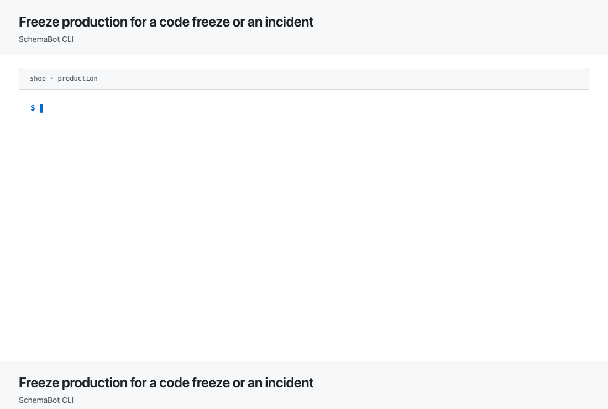
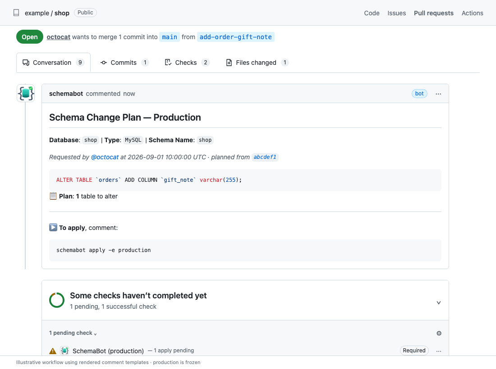
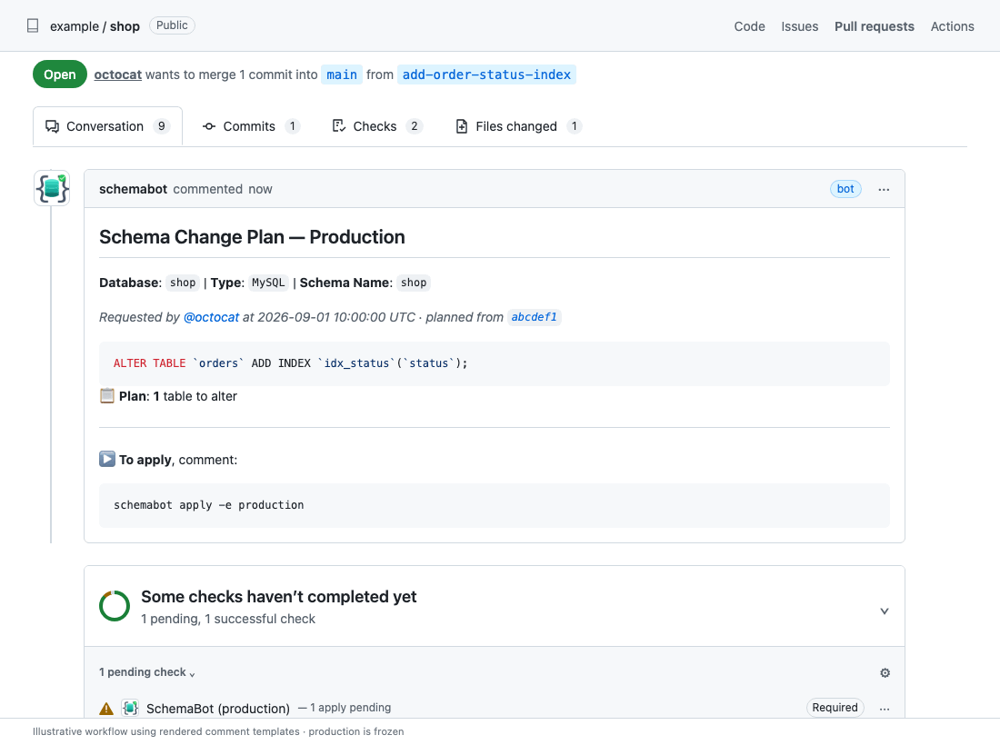

# Freeze an environment

<!-- BEGIN TOC (auto-generated by `make docs-toc`) -->

## Table of Contents

- [Quick start](#quick-start)
- [Schedule a freeze](#schedule-a-freeze)
- [When a freeze refuses your change](#when-a-freeze-refuses-your-change)
- [Ask for an override](#ask-for-an-override)
- [Use the API](#use-the-api)
- [How a freeze works](#how-a-freeze-works)
- [Stop work that is already running](#stop-work-that-is-already-running)
- [Who can do what](#who-can-do-what)
- [Guidance for agents](#guidance-for-agents)
- [Configure who may freeze and approve](#configure-who-may-freeze-and-approve)

<!-- END TOC (auto-generated by `make docs-toc`) -->

A freeze holds new schema changes in an environment until it ends or someone
lifts it. Use one for a code freeze around a holiday or a launch, or to keep
production still during an incident. While a freeze holds, SchemaBot refuses
every new `apply`, `start` and `cutover` it covers, and work that already
started keeps running. A change that can't wait goes through when its
requester overrides the freeze with a reason, which SchemaBot records. A
server can require a second person to approve each override instead; see
[choose the override policy](#choose-the-override-policy).



This guide is for the people who set freezes, the people whose changes a
freeze holds, and the agents that work for either. Every example below is the
real output of the CLI or the API.

## Quick start

Freeze production now. `--reason` is required, and SchemaBot shows it wherever
the freeze holds a change, so write it for the person who meets it:

```console
$ schemabot freeze -e production --reason "Holiday code freeze"
⚠️ freeze-3f9a1c2e7b4d8a06 created: production frozen (on demand, until lifted) by alice. Reason: Holiday code freeze
   Scope:           whole environment
   Starts:          2026-12-18T17:00:00Z
   Running applies: continue
```

See what is frozen:

```console
$ schemabot freeze show freeze-3f9a1c2e7b4d8a06
Freeze freeze-3f9a1c2e7b4d8a06  production (on demand, in effect)
     Scope:    whole environment
     Window:   2026-12-18T17:00:00Z until lifted
     Reason:   Holiday code freeze
     By:       alice
     Running:  continue (applies already running in scope)
     Source:   manual
     Created:  2026-12-18T17:00:00Z
```

Lift it when you are done. Changes that the freeze refused do not run on their
own; their owners run them again.

```console
$ schemabot unfreeze freeze-3f9a1c2e7b4d8a06 --reason "Holidays are over"
✓ freeze-3f9a1c2e7b4d8a06 lifted.
```

To freeze less than the whole environment, add `--database` or `--deployment`.
Each one repeats:

```console
$ schemabot freeze -e production --database shop --database billing --reason "Checkout launch"
```

## Schedule a freeze

A planned freeze starts and ends on its own. Set it ahead of time so everyone
can see it coming. It needs `--end`; times are RFC3339:

```console
$ schemabot freeze -e production --planned --reason "Launch week code freeze" \
    --start 2027-02-01T17:00:00Z --end 2027-02-08T17:00:00Z
⚠️ freeze-b62e0d9c41f7a385 created: production freeze scheduled (planned, until 2027-02-08T17:00:00Z) by alice. Reason: Launch week code freeze
   Scope:           whole environment
   Starts:          2027-02-01T17:00:00Z
   Running applies: continue
```

`freeze list` shows the freezes in effect, the scheduled ones, and the recent
ones of any state. `-e` narrows it to one environment:

```console
$ schemabot freeze list -e production
In effect (1)
  1. freeze-3f9a1c2e7b4d8a06  production (on demand, in effect)
     Scope:    whole environment
     Window:   2026-12-18T17:00:00Z until lifted
     Reason:   Holiday code freeze
     By:       alice

Scheduled (1)
  1. freeze-b62e0d9c41f7a385  production (planned)
     Scope:    whole environment
     Window:   2027-02-01T17:00:00Z until 2027-02-08T17:00:00Z
     Reason:   Launch week code freeze
     By:       alice

Recent (2)
  1. freeze-b62e0d9c41f7a385  production (planned)
     ...
  2. freeze-3f9a1c2e7b4d8a06  production (on demand, in effect)
     ...
```

`unfreeze` ends a planned freeze early, or cancels it before it starts. See
the [CLI reference](cli.md#freeze-an-environment) for every flag.

## When a freeze refuses your change

A refused command starts no new work for that change. It names each freeze in
the way and when it ends. On the CLI it exits 1:

```console
$ schemabot apply -s schema -e production
...
❄️ production is frozen. This change did not start.
   freeze-3f9a1c2e7b4d8a06  Holiday code freeze  (until lifted)
If this change can't wait, run the same command with --override "<reason>".
```

On a pull request, SchemaBot posts the refusal as a comment, and the plan
comment says the change was not applied. The comment lists up to ten freezes
and counts the rest. The API answers `409`; see
[read a refusal](#read-a-refusal).

A pull request warns you sooner. When a freeze covers the change, the plan
comment names it above the DDL, before anyone comments an apply, and its apply
command already carries `--override "<why it can't wait>"`. Replace the
placeholder with your reason: SchemaBot refuses a reason still in angle
brackets, so a command pasted unedited never overrides a freeze. A freeze that
is scheduled but has not started is named with when it starts, so you can
apply, and let the change finish, before it does. The notice only informs: the
apply checks the freezes again, and that check decides. If an apply is refused
for an unsafe change first, the retry command it offers carries `--override`
too.

`schemabot plan` warns you the same way. Under the plan, it names the freezes
in effect and those scheduled, and says to apply with `--override "<reason>"`
if the change can't wait. A plan that apply refuses whatever its flags, such
as one with a blocked change, names no freeze, as the plan comment does not. The response to `POST /api/plan` carries them in
`freezes`, in effect first, each with `in_effect`.

You have two choices:

1. **Wait for the freeze to end**, then run the same command again. This is the right choice for almost every change. `schemabot freeze show <freeze-id>` says when it ends.
2. **Override the freeze** if the change can't wait, such as a hotfix. See below.

When SchemaBot cannot check the freezes, it starts nothing and says to try
again. That is a passing storage problem, not a freeze.

## Ask for an override

An override lets one change through the freezes that refused it. Run the
same command with `--override "<reason>"`. The reason says why this one change
can't wait. It is at most 500 characters and stays on the record, so be
specific.

What happens next depends on the server's
[override policy](#choose-the-override-policy):

- **`reason`, the default:** the change runs at once. SchemaBot stores the override, approved by you on your reason, and the apply's log says the change was admitted on it. The reason covers that one command and the work it starts, nothing more. Any later command the freeze holds, a retry of the same change included, needs its own `--override`, like a deploy override.
- **`approval`:** it takes two people, the person who asks and a freeze approver who is someone else. SchemaBot still refuses the change, records a request, and the approver approves it. Then you run the command again. The rest of this section shows that flow.

On a pull request, the refusal comment says which policy applies: "Go ahead with a reason" for `reason`, "Ask for an override" with the approver teams for `approval`.

### From the CLI

Under the default policy the command with `--override "<reason>"` runs like
any other. Under `approval`, SchemaBot still refuses the change and records
the request. The approver reads the reason:

```console
$ schemabot apply -s schema -e production --override "Hotfix: checkout needs the gift_note column"
...
❄️ production is frozen. This change did not start.
   freeze-3f9a1c2e7b4d8a06  Holiday code freeze  (until lifted)
Override requested: ovr-8c41d2e9a7f03b56. A freeze approver other than you must run 'schemabot freeze approve ovr-8c41d2e9a7f03b56', then run this command again.
Reason the approver sees: Hotfix: checkout needs the gift_note column
```

Send the request ID to a freeze approver. They read it first:

```console
$ schemabot freeze override ovr-8c41d2e9a7f03b56
Override request ovr-8c41d2e9a7f03b56: waiting for approval
  Action:       apply on shop in production
  Target:       shop/@4f53cda18c2baa0c
  Blockers:     freeze freeze-3f9a1c2e7b4d8a06
  Requested by: bob
  Reason:       Hotfix: checkout needs the gift_note column
  Expires:      2026-12-19T18:00:00Z
```

Then they approve it:

```console
$ schemabot freeze approve ovr-8c41d2e9a7f03b56
✓ Approved ovr-8c41d2e9a7f03b56 for apply on shop in production. Requested by bob: Hotfix: checkout needs the gift_note column. It expires at 2026-12-19T18:00:00Z. bob can now re-run the command.
```

Now run the original command again, with or without `--override`, and the
change runs. In the watch view, press **Enter** again for a held `cutover` or
a waiting deploy.

`--override` works the same on `start` and `cutover`. A CLI or API
`rollback` has none: the freeze holds it until the freeze ends or is lifted,
and a rollback from the pull request is never held. `--override` needs a
verified caller: a request through a port-forward or another unverified lane is
refused, because nobody could tell who asked.

### From a pull request



Comment the command with the flag:

```text
schemabot apply -e production --override "Hotfix: checkout needs the gift_note column"
```

The same flag works on `apply-confirm`, `start` and `cutover`. Under the
default policy the command runs. Under `approval`, SchemaBot records the
request for you and the PR author, and its comment names the
request and the teams that may approve it. An approver comments on the same
pull request with the approve command from that comment. On a repository that
several SchemaBot deployments serve, that command already includes the right
`-t <tenant>`; copy it as is:

```text
schemabot freeze approve ovr-8c41d2e9a7f03b56
```

SchemaBot replies with who approved which change. Then comment the original
command again.



### What an approved override covers

Under `approval`, an approved request covers:

- **One change:** the action (`apply`, `start` or `cutover`) and what it acts on. For an apply, that is the schema each member is asked to reach, not the plan, because running the command again plans afresh. A different schema for the same database needs its own request.
- **One person:** the requester. Anyone else whose change the freeze holds asks for their own.
- **Only the freezes that refused it.** If another freeze starts before you run the command again, the approval no longer covers every freeze in the way, and the change is refused again.
- **At most 24 hours.** Within that window the requester may use it more than once, for example to start the same apply again after a stop. An expired request can't be approved; ask again.

Asking again while your request waits for approval keeps the first request
and its first reason, and the refusal says so.

Under `reason` none of this carries over: each command the freeze holds
gives its own reason.

## Use the API

The API is for tools, dashboards and automation. Each call takes the same
credentials as your other SchemaBot calls; see
[connect the CLI and API](auth.md#connect-the-cli-and-api). SchemaBot records
who set, lifted, asked or approved from the verified caller, never from the
request body. A caller it could not verify is recorded as `unverified`.

| Call | Does | Success |
|---|---|---|
| `POST /api/freezes` | Set or schedule a freeze | `201` with the freeze |
| `GET /api/freezes?environment=&recent=` | List freezes `in_effect`, `scheduled` and `recent` (`recent` is 1 to 200, default 20) | `200` |
| `GET /api/freezes/{id}` | Read one freeze | `200` with the freeze |
| `POST /api/freezes/{id}/lift` | Lift a freeze early, or cancel a scheduled one | `200` with the lifted freeze |
| `GET /api/freezes/overrides/{id}` | Read an override request | `200` with the request |
| `POST /api/freezes/overrides/{id}/approve` | Approve an override request asked for on the API or CLI | `200` with the approved request |

### Set a freeze

```bash
curl -sS -X POST "$SCHEMABOT_URL/api/freezes" \
  -H 'Content-Type: application/json' \
  -d '{"environment": "production", "reason": "Holiday code freeze"}'
```

```json
{
  "id": "freeze-3f9a1c2e7b4d8a06",
  "environment": "production",
  "kind": "on_demand",
  "running": "continue",
  "starts_at": "2026-12-18T17:00:00Z",
  "reason": "Holiday code freeze",
  "created_by": "alice",
  "source": "manual",
  "created_at": "2026-12-18T17:00:00Z",
  "in_effect": true
}
```

| Field | Required | Meaning |
|---|---|---|
| `environment` | Yes | The environment to freeze. |
| `reason` | Yes | Why. Shown wherever the freeze holds a change. |
| `databases`, `deployments` | No | Narrow the freeze. Empty covers the whole environment. |
| `kind` | No | `on_demand` (default) or `planned`. A planned freeze needs `ends_at`. |
| `starts_at`, `ends_at` | No | RFC3339. `starts_at` defaults to now. With no `ends_at`, an on-demand freeze holds until lifted. |
| `running` | No | `continue` (default) or `stop`. See [stop work that is already running](#stop-work-that-is-already-running). |

The request body is strict: an unknown field is a `400`, so a typo never
widens a freeze silently. To schedule the launch-week freeze from the CLI
example:

```json
{
  "environment": "production",
  "kind": "planned",
  "starts_at": "2027-02-01T17:00:00Z",
  "ends_at": "2027-02-08T17:00:00Z",
  "reason": "Launch week code freeze"
}
```

The response has `"in_effect": false` until the freeze starts.

### List and lift

`GET /api/freezes?environment=production` returns three arrays of freeze
objects: `in_effect`, oldest start first; `scheduled`, soonest first; and
`recent`, newest first, which also includes the ones in the other two. To see
what holds production now:

```console
$ curl -sS "$SCHEMABOT_URL/api/freezes?environment=production" \
    | jq -c '.in_effect[] | {id, reason, ends_at}'
{"id":"freeze-3f9a1c2e7b4d8a06","reason":"Holiday code freeze","ends_at":null}
```

Lift a freeze with an optional reason:

```bash
curl -sS -X POST "$SCHEMABOT_URL/api/freezes/freeze-3f9a1c2e7b4d8a06/lift" \
  -H 'Content-Type: application/json' \
  -d '{"reason": "Holidays are over"}'
```

```json
{
  "id": "freeze-3f9a1c2e7b4d8a06",
  "environment": "production",
  "kind": "on_demand",
  "running": "continue",
  "starts_at": "2026-12-18T17:00:00Z",
  "reason": "Holiday code freeze",
  "created_by": "alice",
  "source": "manual",
  "lifted_by": "alice",
  "lift_reason": "Holidays are over",
  "lifted_at": "2027-01-04T17:00:00Z",
  "created_at": "2026-12-18T17:00:00Z",
  "in_effect": false
}
```

A lifted or ended freeze stays on record. Lifting one again is a `409`.

### Read a refusal

`POST /api/apply`, `POST /api/start` and `POST /api/cutover` refuse a frozen
change with `409` and `error_code: "change_gate_refused"`. `blockers` lists
each freeze in the way. `ends_at` is missing when a freeze holds until lifted:

```json
{
  "error": "apply rejected: production is frozen by freeze freeze-3f9a1c2e7b4d8a06 until lifted. Reason: Holiday code freeze. Retry after it ends or is lifted.",
  "error_code": "change_gate_refused",
  "blockers": [
    {
      "gate": "freeze",
      "id": "freeze-3f9a1c2e7b4d8a06",
      "reason": "Holiday code freeze"
    }
  ]
}
```

Branch on `error_code` and read `blockers`. The `error` text is for people
and may change.

`503` with `error_code: "change_gate_unavailable"` means SchemaBot could not
check the freezes. Nothing started. Retry with backoff; it is not a freeze.

### Ask for and approve an override

Send the same request again with `override` in its body. On `/api/start` and
`/api/cutover` the body names the `apply_id` instead of the `plan_id`:

```bash
curl -sS -X POST "$SCHEMABOT_URL/api/apply" \
  -H 'Content-Type: application/json' \
  -d '{
    "plan_id": "plan-91d3b7c2e05a4f68",
    "environment": "production",
    "override": "Hotfix: checkout needs the gift_note column"
  }'
```

The change is still refused, and the refusal now carries the recorded
`override_request`:

```json
{
  "error": "apply rejected: production is frozen by freeze freeze-3f9a1c2e7b4d8a06 until lifted. Reason: Holiday code freeze. Retry after it ends or is lifted. Override request ovr-8c41d2e9a7f03b56 needs a freeze approver other than you.",
  "error_code": "change_gate_refused",
  "blockers": [
    {
      "gate": "freeze",
      "id": "freeze-3f9a1c2e7b4d8a06",
      "reason": "Holiday code freeze"
    }
  ],
  "override_request": {
    "id": "ovr-8c41d2e9a7f03b56",
    "environment": "production",
    "action": "apply",
    "target_id": "shop/@4f53cda18c2baa0c",
    "database": "shop",
    "blockers": [
      "freeze freeze-3f9a1c2e7b4d8a06"
    ],
    "reason": "Hotfix: checkout needs the gift_note column",
    "requested_by": "bob",
    "expires_at": "2026-12-19T18:00:00Z",
    "created_at": "2026-12-18T18:00:00Z"
  }
}
```

`target_id` names exactly what the approval covers: for an apply, the database
and a digest of the schema each member is asked to reach (its schema files and
the tables it ignores or drops); for a start or cutover, the apply. Treat it
as opaque.

A freeze approver other than the requester approves it, with no body:

```bash
curl -sS -X POST "$SCHEMABOT_URL/api/freezes/overrides/ovr-8c41d2e9a7f03b56/approve"
```

```json
{
  "id": "ovr-8c41d2e9a7f03b56",
  "environment": "production",
  "action": "apply",
  "target_id": "shop/@4f53cda18c2baa0c",
  "database": "shop",
  "blockers": [
    "freeze freeze-3f9a1c2e7b4d8a06"
  ],
  "reason": "Hotfix: checkout needs the gift_note column",
  "requested_by": "bob",
  "approved_by": "carol",
  "approved_at": "2026-12-18T18:10:00Z",
  "expires_at": "2026-12-19T18:00:00Z",
  "created_at": "2026-12-18T18:00:00Z"
}
```

The requester then sends the original request again, and the change runs.

### Errors

Every error has the standard body, `{"error": "...", "error_code": "..."}`.

| Status | When |
|---|---|
| `400` (`invalid_request`) | A missing `environment` or `reason`, an unknown field, a bad time, a planned freeze with no end, an end in the past, or an override reason that is over 500 characters or still a `<…>` placeholder. |
| `403` | Setting or lifting a freeze without freeze write access; approving an override without being a freeze approver (`write_groups` alone is not enough); asking for or approving an override as an unverified caller; or approving your own request. |
| `404` (`not_found`) | No freeze or override request with that ID. |
| `409` | `change_gate_refused`, or a lift of a freeze already lifted or ended, or an approval of a request already approved, expired, or asked for on a pull request. |
| `500`, `503` | `change_gate_unavailable` or `storage_error`: SchemaBot could not read or write its freeze storage. Nothing changed. Retry with backoff. |

## How a freeze works

| Part | What it means |
|---|---|
| Scope | An environment, such as `production`. Databases and deployments narrow it. Without them it covers the whole environment. |
| Kind | `on_demand` starts now, or at `--start`, and holds until someone lifts it, or until `--end` if you give one. `planned` starts at `--start` and needs `--end`. |
| Held | A new `apply`, a `start` of a stopped or waiting apply, a `cutover`, and a CLI or API `rollback`. A CLI or API rollback has no override: lift the freeze, or roll back from the pull request instead. |
| Not held | `stop`, `cancel`, `revert`, and a pull request rollback. Those make a change smaller or safer, so a freeze never blocks them. |
| Running work | Applies that started before the freeze keep running, unless the freeze [stops them](#stop-work-that-is-already-running). |
| Several freezes | A change is held while any freeze covers it. Each freeze holds until it ends or is lifted. |
| Clock | Whether a freeze is in effect is decided by the database clock, so every SchemaBot server agrees at its edges. Times are RFC3339 and print in UTC. |
| Record | A lifted or ended freeze stays on record, with who set it, who lifted it, and why. |

## Stop work that is already running

By default a freeze lets running applies finish. During an incident you may
want them stopped too. `--running stop` stops each apply in scope as soon as
the freeze is set, including a rollout paused after a failure, and withdraws
a start queued on a stopped apply:

```console
$ schemabot freeze -e production --database shop --running stop --reason "SEV-1234: stop the shop rollout"
⚠️ freeze-e1d07a5b93c26f48 created: production frozen (on demand, until lifted) by alice. Reason: SEV-1234: stop the shop rollout
   Scope:           databases shop
   Starts:          2026-12-18T17:00:00Z
   Running applies: stop
   Stop requested:  apply-5a2c9e71d04b8f36
                    Confirm each one has stopped with 'schemabot status <apply-id>'.
```

Setting it can take a few minutes while SchemaBot records each stop. The CLI
waits, then lists the applies it asked to stop, and any it could not stop with why: a
PlanetScale apply has no stop, so it keeps running. Each stop is recorded with
the freeze as its requester. A stop takes effect as its driver delivers it, so
confirm each one with `schemabot status <apply-id>`.

The API returns the same as `stop_sweep` on a `running: "stop"` freeze that is
in effect at once: `stopped`, `not_stopped` (each with `apply_id` and
`reason`), and `error` when SchemaBot could not list the applies in scope.

```json
"stop_sweep": {
  "stopped": ["apply-5a2c9e71d04b8f36"]
}
```

A planned `stop` freeze holds what has not started once it begins. It stops an
apply that is already running only at the apply's next checkpoint: when a
rollout starts its next deployment, or when SchemaBot recovers a drive that
crashed or failed. An apply that reaches neither keeps running.

`schemabot status`, the watch view and the pull request comment name the
freeze that stopped an apply. Once that freeze ends, a plain
`schemabot start <apply-id>` resumes it from its checkpoint.

## Who can do what

| Action | Who | Where |
|---|---|---|
| See freezes and override requests | Anyone with read access | CLI, API |
| Set or lift a freeze | `write_groups`, or [`freeze.groups`](configuration.md#freeze-groups-forward-auth) members | CLI, API |
| Ask for an override | A verified caller whose change a freeze refused | CLI, API, pull request |
| Approve an override asked for on the CLI or API | A verified `freeze.groups` member other than the requester | CLI, API |
| Approve an override asked for on a pull request | A `freeze.github_teams` member other than the requester and the PR author | That pull request |

Three rules hold everywhere:

- **Nobody approves their own request.** Under the default [`reason` policy](#choose-the-override-policy) nobody approves: the requester's recorded reason admits the change. Under `approval` an override always takes two people.
- **Write access does not approve.** `write_groups` may set and lift freezes, but only a freeze approver may approve an override.
- **Approve where it was asked.** A request asked for on a pull request is approved on that pull request, and a request asked for on the CLI or API is approved there. SchemaBot refuses an approval from the other side and says where to go.

## Guidance for agents

A freeze is a decision people made, for a launch, a holiday or an incident.
An agent reads freezes and reports them. It never works around one. The
[SchemaBot agent skill](../skills/schemabot/references/command-policy.md)
carries these rules, and [working with AI agents](ai-agents.md) explains why.

| An agent may | An agent hands it to a person |
|---|---|
| Run `freeze list` and `freeze show`, and call the `GET` routes | Set a freeze, with `freeze` or `POST /api/freezes` |
| Read an override request with `freeze override` | Lift a freeze, with `unfreeze` or `POST /api/freezes/{id}/lift` |
| Tell the user a change is frozen, by whom, why, and until when | Ask for an override with `--override`, in any environment |
| Wait and check again, or suggest waiting | Approve an override, on the CLI, the API or a pull request |

Recognize a refusal by its signal, not its wording:

- **CLI:** exit code 1 with the `❄️ <environment> is frozen` line, and nothing started.
- **API:** `409` with `error_code: "change_gate_refused"`. Read `blockers` for the freezes.
- **Pull request:** a comment whose heading starts with `❄️` and contains `Blocked by`: `Blocked by a Freeze` for one freeze, `Blocked by Freezes` for several. The plan comment also says the change was not applied.

When a freeze refuses a change, the agent:

1. Stops. It does not retry in a loop, rewrite the change, or try another environment, deployment or credential to get past the freeze.
2. Tells the user which freeze holds the change, its reason, and when it ends.
3. Hands over the exact `--override` command if the user says the change can't wait. The override reason is recorded as the user's, so the user writes it and runs it.

A plan comment's `❄️ <environment> is frozen` notice is a warning, not a
refusal, and the same rules hold: the agent tells the user, and the apply
command with `--override` in that comment is the user's to post.

`change_gate_unavailable` is different: it is a retryable storage problem.
Retry it with backoff, like any other `503`.

An agent with the [SchemaBot agent skill](ai-agents.md#install-the-agent-skill)
already follows these rules.

## Configure who may freeze and approve

`write_groups` members may set and lift freezes. To let others, such as
release managers or incident commanders, do so without any other write
access, list their groups in `freeze.groups`. Its members also approve
overrides asked for on the CLI or API. `freeze.groups` needs
`auth.type: forward_auth`.

```yaml
freeze:
  groups: [release-managers, incident-commanders]
  github_teams: [acme/release-managers]
```

`freeze.github_teams` names the GitHub teams, as `org/team-slug`, whose
members approve overrides asked for on a pull request. SchemaBot reads team
membership through the repository's installation, which needs the GitHub
App's **Members: Read** permission. With no team listed, nobody can approve
from a pull request, and the refusal says so.

See [freeze groups](configuration.md#freeze-groups-forward-auth) for every
rule, and [GitHub App setup](github-app-setup.md) for the permission.

### Choose the override policy

`freeze.override_policy` decides what `--override "<reason>"` does when a
freeze refuses a change:

| Policy | What `--override` does |
|---|---|
| `reason` (the default) | Admits the change at once on the requester's reason, with no approver, like an audited deploy override. |
| `approval` | Records a request that a freeze approver other than the requester and the PR author must approve. The requester then runs the command again. |

The default treats a freeze as a pause that people honor: it stops changes
until someone decides theirs can't wait and says why. The reason is still
required and still audited. SchemaBot stores the override approved by its
requester, with the reason, and the apply's log says the change was admitted
on the requester's reason. The reason admits only the command that gave it:
a retry, or a later `start` or `cutover`, gives its own. A caller SchemaBot
can't verify gets no override under either policy.

Set `approval` when every exception needs a second person:

```yaml
freeze:
  override_policy: approval
  groups: [release-managers]
  github_teams: [acme/release-managers]
```

Under `approval`, approving from a pull request needs `freeze.github_teams`,
and approving on the CLI or API needs `freeze.groups`. With neither, nobody
can approve, and the only way past a freeze is to lift it.
