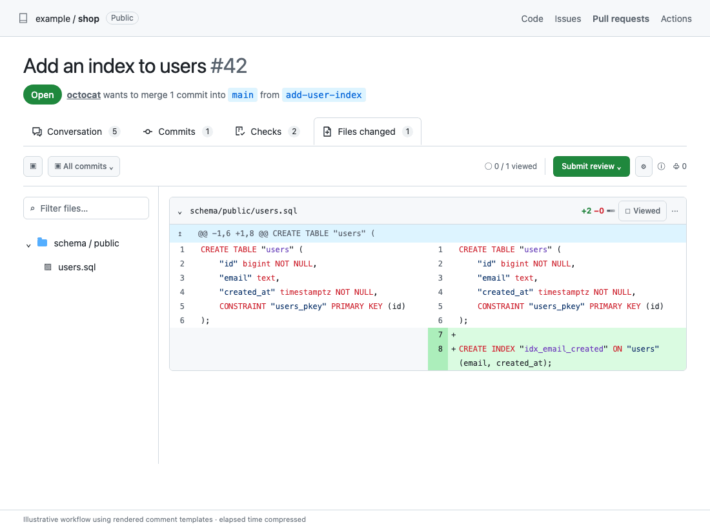

# PostgreSQL

<!-- BEGIN TOC (auto-generated by `make docs-toc`) -->

## Table of Contents

- [Beta status](#beta-status)
- [Quick start](#quick-start)
- [What runs and what is blocked](#what-runs-and-what-is-blocked)
- [Example: add a column and an index](#example-add-a-column-and-an-index)
- [Where it runs](#where-it-runs)
- [What pg-sprite does](#what-pg-sprite-does)
- [How a change runs](#how-a-change-runs)
- [Supported changes](#supported-changes)
- [Blocked plans](#blocked-plans)
- [Apply-time refusals](#apply-time-refusals)
- [Unsupported workflow features](#unsupported-workflow-features)
- [Guidance for agents](#guidance-for-agents)
- [Schema pull](#schema-pull)
- [Row-level security](#row-level-security)
- [Configuration and credentials](#configuration-and-credentials)
- [Table ownership](#table-ownership)
- [Failure and recovery](#failure-and-recovery)
- [Progress reporting](#progress-reporting)
- [SchemaBot storage](#schemabot-storage)
- [Supabase compatibility tests](#supabase-compatibility-tests)
- [Engine capability mapping](#engine-capability-mapping)

<!-- END TOC (auto-generated by `make docs-toc`) -->

SchemaBot keeps a PostgreSQL schema in version control. You declare each table
in a `.sql` file, SchemaBot compares the files with the live database, and you
review the exact SQL before anything runs.
[pg-sprite](https://github.com/block/pg-sprite), an open-source schema change
engine for PostgreSQL, plans and runs each change.



PostgreSQL support is in **beta**. A change that pg-sprite cannot run without a
long lock is blocked in the plan, before anything touches the database, and the
plan says why. This guide is for the people who run SchemaBot against
PostgreSQL, the people whose pull requests change a PostgreSQL schema, and the
agents that work for either.

## Beta status

SchemaBot runs the changes listed under "What works today" and refuses
everything else with the reason, in most cases when you plan it. It never
falls back to a riskier way of running a change.
[What GA, beta, and alpha mean](engines.md#what-ga-beta-and-alpha-mean)
explains the levels. Changes run through
[pg-sprite](https://github.com/block/pg-sprite#readme), which is itself an
early release.

**What works today:**

- Plans on every pull request and in the CLI, showing the exact SQL. Make the
  Check Run a [required check](check-runs.md#branch-protection-setup), so a
  pull request cannot merge until the live schema matches it.
- `ALTER TABLE` changes that only change the catalog, such as adding a
  nullable column, on a table of any size. See
  [Catalog-only changes](#catalog-only-changes).
- Other `ALTER TABLE` changes that don't rewrite the table, such as adding a
  check constraint, on tables up to the size limit (1 GiB by default).
- Adding an index to an existing table with `CREATE INDEX CONCURRENTLY`. You
  can cancel a running build.
- Adding an index to a partitioned table, one partition at a time. Applying
  again after a cancel or failure resumes from the partitions already built.
- Creating a table together with its indexes.
- Adding a foreign key to an existing table, or creating a table that has
  one. See [Foreign keys](#foreign-keys).
- Dropping a table whose schema file was deleted, after you approve the drop
  with `--allow-unsafe`. See [Tables with no schema file](#tables-with-no-schema-file).
- Adding labels to an existing enum type. See [Enum types](#enum-types).
- Row-level security policies on an existing table, or on a new table.
- `schemabot init` and `schemabot pull` for an existing database.
- PostgreSQL as the database that stores SchemaBot's own state.

**Not GA yet.** SchemaBot blocks or refuses these; it never runs them:

| Change | Status |
|---|---|
| Rewriting a table, such as changing a column's type | Blocked. It needs pg-sprite's copy-and-swap, which is still in preview |
| `ALTER TABLE` on a table larger than the size limit, unless it only changes the catalog | Blocked, for the same reason |
| Dropping a foreign key | Blocked. See [Foreign keys](#foreign-keys) for running one yourself |
| Creating an enum type, or removing or reordering its labels | Blocked |
| `stop`, `start`, `cutover`, deferred cutover, `revert`, `skip-revert` | Not available. Only an index build can be cancelled. See [Unsupported workflow features](#unsupported-workflow-features) |
| Some changes to a partitioned table's parent | Refused when the apply runs. See [Partitioned tables](#partitioned-tables) |
| Row-level security changes and structural changes to one existing table in the same plan | Blocked. See [Row-level security](#row-level-security) |
| Pulling every table shape | `pull` skips a table it cannot write completely and names it, rather than writing a partial file. `onboard` and `init` add it to `ignore_tables`. See [Schema pull](#schema-pull) |
| Detailed catalog output from the schema intelligence API | Not available |

**A passing plan is not a promise that the apply will succeed.** Some checks
can only run against the live table when the apply starts:

- A statement the planner expected to be quick that turns out to rewrite the
  table is cancelled by its time budget, and nothing is changed.
- A table that grew past the size limit after the plan is refused, unless
  the statement only changes the catalog.
- A plan with several statements is not atomic. They run in order, so if one
  fails, the ones before it stay applied. Keep a change to one statement when
  a half-applied plan would be unsafe to leave in place.

[Apply-time refusals](#apply-time-refusals) lists every check that runs then.

## Quick start

### Try it on a sample database

With Docker running, run `schemabot init` in an empty directory, choose **Try a
sample database**, and pick PostgreSQL. SchemaBot starts a local PostgreSQL
container, seeds two tables, pulls them into schema files, and confirms the
files match the database. Edit a file, then review and run the change:

```bash
schemabot plan -s schema -e development
schemabot apply -s schema -e development
```

When init prints its next command with a `--profile` flag, add the same flag to
both. [Initialize a database](init.md) walks through each step.

### Bring an existing database

Run `schemabot init` and enter your PostgreSQL connection string. The wizard
lists the application schemas the connection can read, pulls the ones you
select into one directory each, and verifies that planning the new files
against the database finds no changes. It never changes your application
tables. Connect to the read-write primary through a direct or session-mode
endpoint; [Where it runs](#where-it-runs) explains why a transaction-mode
pooler does not work.

Each PostgreSQL schema gets its own directory, and each table is one file:

```
myapp/schema/
├── schemabot.yaml
└── public/
    ├── customers.sql
    └── orders.sql
```

```yaml
# schemabot.yaml
database: app
type: postgres
```

The SchemaBot server needs a connection for each environment:

```yaml
databases:
  app:
    type: postgres
    environments:
      staging:
        dsn: "env:APP_STAGING_DSN"
      production:
        dsn: "env:APP_PRODUCTION_DSN"
```

A DSN is a PostgreSQL URL or keyword/value string, such as
`postgres://schemabot@db.example.com:5432/app?sslmode=verify-full`. Set
`sslmode` explicitly. [Configuration and
credentials](#configuration-and-credentials) covers TLS and the other ways to
supply a DSN.

### Grant the roles SchemaBot needs

| To | The connected role needs |
|---|---|
| Plan | `CONNECT` on the database, `USAGE` on each schema, and `CREATE` on the database. Planning builds the desired tables in a scratch schema inside a transaction it always rolls back, so it also needs the read-write primary, not a hot standby |
| Alter a table | To own the table, or to be a member that inherits the owner role |
| Add an index to an existing table | The same, plus `CREATE` on the schema. Grant it to the owner role, and the connected role inherits it |
| Create a table | `CREATE` on the schema. With `table_owner` set, the connected role needs membership in that owner role instead, and the owner role needs `USAGE` and `CREATE` on the schema |
| Add a foreign key | The same as altering the table, plus `REFERENCES` on the referenced table. An owner role that owns both tables has it |
| Cancel an index build | Nothing more. Membership in `pg_signal_backend` lets the cancel reach the build's backend directly |

SchemaBot checks the privileges each statement needs on its own table before
running it, and a missing grant fails with the `GRANT` that fixes it. A plan
that adds a foreign key also checks `REFERENCES` on the referenced table, and
fails with the grant to add when it is missing.

If a grant is revoked after the plan, the apply fails at the statement that
needs it, and statements before it may already have run:

- A privilege on the statement's own table is checked again before the
  statement runs. The failure names the `GRANT` that fixes it. The apply fails:
  grant the privilege, then plan and apply again. The new plan holds only the
  statements that did not run.
- `REFERENCES` on the table a foreign key references is checked only by the
  server. The failure says a privilege is missing, and the server log names it.
  SchemaBot retries the apply on its own, so grant the privilege and it carries
  on. If its retries run out first, plan and apply again.

If your tables belong to a dedicated owner role, read
[Table ownership](#table-ownership) before the first `CREATE TABLE`.

## What runs and what is blocked

| Change | What happens |
|---|---|
| Add a nullable column, or another `ALTER TABLE` that only changes the catalog | Runs on a table of any size, with a 3-second `lock_timeout` and a 30-second `statement_timeout`. See [Catalog-only changes](#catalog-only-changes) |
| `VALIDATE CONSTRAINT` of a constraint left `NOT VALID` | Runs on a table of any size, bounded by `postgres.validate_max_duration` (24 hours by default). Reads and writes continue through the scan |
| Any other `ALTER TABLE` on a table larger than 1 GiB | Blocked. The limit is `postgres.native_safe_table_size_limit_bytes` |
| `ALTER TABLE` that rewrites the table, such as most column type changes | Blocked. It needs a copy of the table, which SchemaBot does not run on PostgreSQL yet |
| `CREATE INDEX` on an existing table | Runs as `CREATE INDEX CONCURRENTLY`, bounded by `postgres.concurrent_index_max_duration` (24 hours by default). It can be cancelled |
| `CREATE INDEX` on a partitioned table | Built one partition at a time, each concurrently, under the same bound. It can be cancelled, and applying again resumes from the partitions already built. See [Partitioned index builds](#partitioned-index-builds) |
| Dropping an index | Runs as `DROP INDEX CONCURRENTLY` after you approve it with `--allow-unsafe`, on a table of any size. Reads and writes continue while it waits for open transactions, up to 4 minutes. See [Dropping an index](#dropping-an-index) |
| A new table, with its indexes | Runs together: the table, then its indexes, built without `CONCURRENTLY` because nothing reads the table yet. See [Greenfield tables](#greenfield-tables) |
| A new label on an existing enum type | Runs as `ALTER TYPE ... ADD VALUE`, one label per step, before the table changes. Creating a type or removing a label fails the plan. See [Enum types](#enum-types) |
| Row-level security policies on an existing table | Run in one transaction, after you explicitly approve them, because they change who can read rows. See [Row-level security](#row-level-security) |
| A new table with row-level security | Runs in one transaction: the table, its RLS setting, and its policies, so the table never exists without them. It holds no rows, so it needs no approval. See [Row-level security](#row-level-security) |
| Adding a foreign key | Runs in two steps: `ADD CONSTRAINT ... NOT VALID`, then `VALIDATE CONSTRAINT`, which checks existing rows while writes continue. See [Foreign keys](#foreign-keys) |
| Dropping a foreign key | Shown in the plan, but blocked. See [Foreign keys](#foreign-keys) |
| Making a column `NOT NULL` | Runs in four steps on a table up to the size limit: a helper `CHECK (column IS NOT NULL) NOT VALID`, `VALIDATE CONSTRAINT`, which checks existing rows while writes continue, `SET NOT NULL`, which uses the validated check instead of scanning, and the helper's drop. If a row holds `NULL`, the validation fails and names the helper. Fix those rows and SchemaBot retries the validation on its own. If its retries run out first, plan and apply again. The new plan drops the leftover helper before it adds a new one, and that drop is unsafe, so the apply needs `--allow-unsafe` |
| A table with no schema file, or a deleted file | Runs as `DROP TABLE` after you approve it with `--allow-unsafe`, as on MySQL. Archive tables and `ignore_tables` entries are left alone. See [Tables with no schema file](#tables-with-no-schema-file) |

Once a statement starts, it runs until it commits or its timeout ends it; it
cannot be paused. An index build is the one change you can cancel while it
runs. [Unsupported workflow features](#unsupported-workflow-features)
lists the SchemaBot controls that do not apply to PostgreSQL.

The [reference](#supported-changes) below covers every rule behind this
table.

### Catalog-only changes

Some `ALTER TABLE` changes write only PostgreSQL's catalog and never read or
rewrite the table's rows. They take the same few milliseconds on a table of
any size, so the size limit does not apply to them.

| Change | Catalog-only when |
|---|---|
| `ADD COLUMN` | pg-sprite proves against the live table that it neither rewrites nor scans the rows, its default is absent or a constant, and its type is built in or an enum |
| `DROP COLUMN`, `DROP DEFAULT`, `DROP NOT NULL`, `DROP CONSTRAINT` | Always |

A `NOT NULL` column with no default still counts against the size limit,
because PostgreSQL scans the rows to check it. So does a default such as
`now()`, any user-defined type other than an enum (a domain, composite, or
range type), and a statement that mixes a catalog-only change with any other
change.

`SET DEFAULT` counts against the size limit too. PostgreSQL converts the new
default to the column's type while it holds the table lock, and for a
user-defined type that runs the type's own code, which can read any table.

pg-sprite proves the change against the live table when SchemaBot plans it,
and again when the apply starts. What happens at the second proof:

| Second proof | Apply |
|---|---|
| Still catalog-only | Runs |
| No longer catalog-only | Refused on size |
| The engine role cannot create the proof's temporary table | Refused until you grant `TEMPORARY` on the database to that role |
| Fails for another reason, such as a dropped connection | Fails without running anything; retry it |

## Example: add a column and an index

The `orders` table exists, and the pull request adds a `note` column and an
index on `customer_id`:

```sql
CREATE TABLE "orders" (
    "id" bigint NOT NULL,
    "customer_id" bigint NOT NULL,
    "note" text,
    CONSTRAINT "orders_pkey" PRIMARY KEY (id)
);

CREATE INDEX "orders_customer_id_idx" ON "orders" (customer_id);
```

The plan has two statements. The column is an `ALTER TABLE ... ADD COLUMN`
that only changes the catalog, and it commits in milliseconds. The index is
shown as `CREATE INDEX CONCURRENTLY`, even though the file says `CREATE INDEX`,
because pg-sprite chose the form that does not block writes. Review the SQL as
shown, since that is what will run.

On apply, the two statements run one after the other, and each commits on its
own. If the index build fails, the column stays added, and the build can be
retried. Keep a pull request to one statement when a half-applied
change would be unsafe to leave in place.

PostgreSQL target support is separate from using PostgreSQL to store
SchemaBot's own state; see [SchemaBot storage](#schemabot-storage).

## Where it runs

SchemaBot works with PostgreSQL 14 and later, self-hosted or managed,
including the providers below. CI tests self-hosted PostgreSQL and the
[Supabase PostgreSQL image](#supabase-compatibility-tests). It does not test
hosted Supabase projects, Supavisor, or PlanetScale Postgres, so treat those
rows as connection guidance rather than tested support.

| Provider | Connect to |
|---|---|
| Amazon RDS for PostgreSQL | The instance endpoint |
| Amazon Aurora PostgreSQL | The cluster's writer endpoint, not a reader endpoint |
| Supabase | The direct connection, or the Supavisor session pooler. Not the transaction pooler |
| PlanetScale Postgres | The direct connection. Not the PgBouncer endpoint |

Whatever the provider, connect to the read-write primary through a direct or
session-mode endpoint. This applies to every target and to SchemaBot's own
storage:

- **Targets.** A transaction-mode pooler can move a schema change's session
  settings, such as its `statement_timeout`, onto another client's backend.
  SchemaBot does not detect a pooler on a target DSN.
- **Storage.** SchemaBot coordinates its instances with session-scoped
  advisory locks. See [SchemaBot storage](#schemabot-storage).

Your application keeps whatever pooling it already uses.

## What pg-sprite does

In PostgreSQL, a schema change that looks cheap can rewrite every row while
holding an `ACCESS EXCLUSIVE` lock, which blocks reads and writes on the table
until it finishes. Whether an `ALTER TABLE` rewrites depends on the column
type, the default expression, and the server version. PostgreSQL has no option
to refuse a statement that would rewrite, and nothing warns you first.

pg-sprite fills that gap. Its planner classifies each change before it runs
and picks the safest form PostgreSQL offers:

- A `CREATE INDEX` becomes `CREATE INDEX CONCURRENTLY`.
- A new constraint is added `NOT VALID`, then validated.
- Each attempt runs under a short `lock_timeout` and `statement_timeout`. A
  change that turns out to be expensive is cancelled and rolled back instead
  of holding the table. Index builds have a longer bound of their own; see
  [Index builds](#index-builds).
- Before an attempt requests its lock, it waits up to 30 seconds, outside the
  lock queue, for a read or write transaction that has held a conflicting
  lock for longer than a moment. A prepared transaction is not waited on.
  While the step waits, the table's readers and writers do not queue behind
  it, and the CLI and the PR comment name the session, for example
  `⏳ Waiting for session 9433 to release its lock (7s of 30s)`. Once the
  30 seconds run out, the attempt requests its lock anyway, under its short
  `lock_timeout`, so readers and writers queue behind it for at most that
  long.
- When no safe form exists, pg-sprite refuses the change and says why.

pg-sprite supports PostgreSQL 14 and later, including Amazon RDS and Aurora.

The two projects split the work:

| pg-sprite | SchemaBot |
|---|---|
| Compares a desired `CREATE TABLE` with the live table | Finds the schema files in a repository and plans every schema they cover |
| Decides whether each statement can run safely, and in what form | Shows the plan on the pull request and in the CLI, and can block the merge until it is applied |
| Runs one statement under its timeouts, and reports progress | Runs each environment's changes in order, survives restarts, and records history |

pg-sprite is also usable on its own as a CLI and Go library. This guide covers
it only as SchemaBot uses it. Its
[capability matrix](https://github.com/block/pg-sprite/blob/main/docs/capabilities.md)
lists what the engine supports today, what is planned, and what is out of
scope.

## How a change runs

A pull request edits `schema/public/orders.sql`:

```
  PR edits schema/public/orders.sql
                    │
                    ▼
  ┌───────────────────────────────────┐
  │ plan                              │
  │ pg-sprite compares the files with │
  │ the live database and classifies  │
  │ each statement                    │
  └─────────────────┬─────────────────┘
                    │
           ┌────────┴──────────────┐
           │ native                │ anything else
           ▼                       ▼
  ┌──────────────────┐    ┌──────────────────┐
  │ review           │    │ blocked          │
  │ the PR comment   │    │ the check fails  │
  │ and CLI show the │    │ and names the    │
  │ exact SQL        │    │ reason           │
  └────────┬─────────┘    └──────────────────┘
           │ apply
           ▼
  ┌───────────────────────────────────┐
  │ re-check table size, privileges,  │
  │ and names, then run each          │
  │ statement under lock and time     │
  │ budgets                           │
  └───────────────────────────────────┘
```

A change can be applied only when pg-sprite can run it as ordinary PostgreSQL
DDL that does not hold a long lock. pg-sprite calls this a *native* change.
Anything else, such as a change that would need the table copied, blocks the
plan. A blocked plan cannot be overridden with a flag. Rewrite the change into
a form pg-sprite accepts, or make it outside SchemaBot through a separately
reviewed process.

## Supported changes

The rest of this guide is the reference: the exact rules SchemaBot and
pg-sprite apply, and what you see when one of them refuses a change.

**How statements are applied.** Each statement runs as its own task, in its
own transaction, in plan order. Two kinds of change run as a single task:

- A row-level security replacement runs as one atomic transaction. See
  [Row-level security](#row-level-security).
- A new table and its indexes run as one ordered sequence, each step in its
  own transaction. See [Greenfield tables](#greenfield-tables).

**A plan is not atomic.** If a statement fails, the statements before it stay
committed. Keep a change to one statement when a half-applied plan would be
unsafe to leave in place.

**What every statement must satisfy:**

- pg-sprite classifies it as native.
- It is an `ALTER TABLE` that pg-sprite's privilege check accepts, a
  `CREATE TABLE` for a new table, or a `CREATE INDEX`. Anything else is
  blocked.
- A change to an existing table targets an ordinary or partitioned table.
- The connected role holds the privileges the statement needs. A new table
  needs `CREATE` on its schema.

**Limits:**

| Statement | Limit | Setting |
|---|---|---|
| `ALTER TABLE` | Table size, including every partition of a partitioned table. 1 GiB by default. A catalog-only change has no size limit | `postgres.native_safe_table_size_limit_bytes` |
| `ALTER TABLE` | Each attempt gets a 3-second lock budget, retried on contention, and a 30-second statement budget | Fixed |
| `CREATE INDEX CONCURRENTLY` | Build duration, enforced as the server-side `statement_timeout`. 24 hours by default | `postgres.concurrent_index_max_duration` |
| Index on a partitioned table | The same duration, for each partition and for the whole build | `postgres.concurrent_index_max_duration` |
| `VALIDATE CONSTRAINT` | Scan duration, enforced as the server-side `statement_timeout`. 24 hours by default. No table size limit. Each attempt gets the same 3-second lock budget as `ALTER TABLE`, or half the bound when the bound is shorter | `postgres.validate_max_duration` |
| `CREATE TABLE` | No size limit, since the table starts empty | None |

The size limit bounds work that grows with existing data, so index builds,
validations, and new tables are bounded by duration instead. The duration starts when the build
starts: session setup has its own allowance, so the build gets the full bound.
[Configuration](configuration.md) covers the trade-offs of raising either
setting.

The planner, not a fixed list in SchemaBot, decides whether an `ALTER TABLE`
is native. Adding a nullable column is the common case:

```sql
ALTER TABLE public.users ADD COLUMN email text;
```

Check the plan for the verdict on your exact schema.

### Index builds

A `CREATE INDEX` on an existing table is built concurrently, so writes
continue while it runs.

- **The plan shows the concurrent form.** pg-sprite rewrites a plain
  `CREATE INDEX` as `CREATE INDEX CONCURRENTLY`, and the plan shows that SQL.
  A statement already written with `CONCURRENTLY` is shown as written. If
  pg-sprite cannot build the concurrent form, the plan is blocked.
- **The build runs outside a transaction**, with `lock_timeout` off and
  `statement_timeout` set to `postgres.concurrent_index_max_duration`. The
  server's own timer ends a build that runs too long.
- **The build completes only when the catalog shows the index valid.**
- **The table size limit does not apply.** The duration bound does instead.

Indexes declared together with a new table are different: they are built
without `CONCURRENTLY` as part of creating the table, because nothing reads it
yet. See [Greenfield tables](#greenfield-tables).

#### When a build fails

*Retryable* means SchemaBot tries again on its next drive. *Refused* means
applying the same plan again meets the same refusal.

| What happened | Result | What to do |
|---|---|---|
| The build failed part-way and left an invalid index | Retryable. The failure names the index | Nothing. The next drive removes the invalid index and builds again |
| The duration bound ended the build | Retryable. The failure names `postgres.concurrent_index_max_duration` | Raise the setting before the retry, or it meets the same bound |
| The duration bound ended the build, and it left nothing behind | Refused. The failure names the setting | Raise the setting, then apply again |
| The build failed on the table's rows, such as duplicates under a unique index | Refused | Fix the rows, then apply again |
| Another backend still holds the index or the table | Retryable. The failure names the index and the backend | Nothing. SchemaBot retries once that build ends |
| An invalid index has the name but cannot be cleared by this change: it is on another table, backs a constraint, or belongs to a partitioned table | Refused. The failure names the index | Remove the index yourself, then apply again |
| The target connection pool cannot hold the sessions the build needs | Refused | Raise the pool size in the target DSN |
| `CONCURRENTLY` on a partitioned table's parent | Refused. PostgreSQL cannot build it | Write it without `CONCURRENTLY`. See [Partitioned index builds](#partitioned-index-builds) |

#### If SchemaBot restarts mid-build

Losing the SchemaBot instance does not stop the build. The server keeps
building until the build finishes, fails, or reaches its timeout. The next
drive finds one of three things:

- **A valid index.** Nothing is left to do.
- **A build still running.** The apply waits as a retryable failure that names
  the index and the backend building it.
- **An invalid index left behind.** The next drive recovers it.

#### How SchemaBot recovers an invalid index

When a build finds an invalid index under its name, or one an interrupted
recovery left on the table, it runs pg-sprite's recovery:

1. Lock the table. Holding the lock proves no build still owns the index. If
   a build still holds the table, the lock wait times out and the apply
   retries.
2. Drop the invalid index.
3. Build the index again.

All three steps run under one deadline of the same duration bound. The
recovery needs one more connection than the build alone.

Leave an invalid index in place for SchemaBot to recover. Dropping it by hand
can race a build the server is still running.

### Partitioned index builds

PostgreSQL cannot build an index on a partitioned table's parent
concurrently, and a plain `CREATE INDEX` on the parent blocks writes to every
partition until it finishes. So when a schema file adds an index to a
partitioned table, the plan shows the parent's statement, such as
`CREATE INDEX events_kind_idx ON ONLY public.events USING btree (kind)`, and
the apply runs it through pg-sprite's partitioned index build:

1. Create the index on the parent only. It starts invalid.
2. For each partition, build its index concurrently and attach it to the
   parent's index.
3. Confirm the parent's index is valid, which PostgreSQL allows only once
   every partition has an attached index.

The build holds an advisory lock on the parent throughout and needs a target
connection pool of at least two connections. Each partition's build, and the
build as a whole, is bounded by `postgres.concurrent_index_max_duration`. The
table size limit does not apply.

**The build resumes.** A partition whose index is already built and attached
is kept. Applying the same plan again after a failure, a cancel, or a shutdown
builds only the partitions that are left.

| What happened | Result |
|---|---|
| The deadline passed after at least one partition finished | Retryable. The retry continues from the next partition |
| The deadline passed before any partition finished | Refused, since a retry would spend the same deadline on the same partition. Raise `postgres.concurrent_index_max_duration`, then apply again |

The plan refuses shapes the build cannot run: a `TABLESPACE` clause,
`IF NOT EXISTS`, or an unnamed index. If the table is no longer partitioned
when the apply runs, the apply is refused before it touches the table and asks
you to plan again.

### Control operations

You can cancel two kinds of change while they run: a concurrent index build on
an existing table, and a partitioned index build. Every other statement
commits or fails on its own, so SchemaBot records a cancel of it and then
declines it. A declined cancel of a `VALIDATE CONSTRAINT` says when the scan
ends on its own: within `postgres.validate_max_duration`. If the scan runs
out, the constraint stays `NOT VALID` and still checks new writes.

**How a cancel reaches the build.** SchemaBot signals the build's backend. If
the signal cannot reach it, for example because the build has not started or
the role cannot see its backend, SchemaBot ends the apply's own work instead.
The cancel takes effect either way. Membership in `pg_signal_backend` lets the
signal reach the backend directly.

**What the cancel reports.** SchemaBot reports where the apply ends up, not
whether the signal was sent. After a build stops, SchemaBot drops the invalid
index it left, once it proves nothing still builds it.

| What happened | Reported as |
|---|---|
| The build stopped and SchemaBot dropped its invalid index | `cancelled` |
| The build stopped and left no index | `cancelled` |
| The build stopped, but the server would not drop the index concurrently | `cancelled`. The summary names the index, under its quarantine name, for you to drop |
| The build stopped, but SchemaBot could not tell which index was left | `cancelled`. The summary gives both possible names and the catalog query that finds it |
| The build finished before the signal landed | Completed |
| The apply had already failed | `cancelled`, with the failure detail |
| The build did not stop within SchemaBot's wait | Still running. The next cancel waits again |

Cleanup has a short time limit of its own, so a slow cleanup cannot turn a
cancel into a timeout. SchemaBot does not retry cleanup after the apply ends:
an index it could not drop stays until you remove it. The full cleanup error
is in the server logs.

**A partitioned build** settles as `cancelled` and removes nothing. No later
partition starts. The partitions already built keep their index, and applying
the plan again resumes from them.

**On shutdown**, SchemaBot stops its running index builds the same way, so no
build keeps running under a lease that nobody renews. This is not a cancel:
the apply stays active, and the next driver recovers the invalid index or
resumes the partitioned build. Other statements are left to finish. If the
shutdown time runs out first, SchemaBot reports that the target may still be
locked.

**Stop is not supported.** A concurrent build has no midpoint to resume from,
so a stop would be a cancel under another name. Other statements have nothing
to pause.

### Greenfield tables

A `CREATE TABLE` for a table that does not exist yet runs through pg-sprite's
create path. The schema file can declare the table's indexes with it, and
SchemaBot applies the table and its indexes as one task, in order. The indexes
are built without `CONCURRENTLY`, because nothing reads the table yet.

Each step commits in its own transaction. If a step fails, the table and the
earlier indexes stay. SchemaBot never retries the same set: the failure names
the failed step and the table it created, then says how to fix the problem,
or to plan again so the next plan starts from the live table.

**Checked when the apply runs.** The create checks two facts in the session
that runs it, because checking them at plan time proves nothing later:

- The role holds `CREATE` on the schema.
- The table's name is free.

**Owner role.** With `table_owner` set, each create step runs
`SET LOCAL ROLE` to that role, so its default privileges apply to the table
and its serial sequences.

- The connected role needs membership in the owner role
  (`GRANT app_owner TO schemabot`).
- The owner role needs `USAGE` and `CREATE` on the schema.
- The plan checks the membership. A missing one blocks the step with the
  `GRANT` that fixes it, and an owner role that does not exist on the target
  blocks it outright.
- `table_owner` names one role for the whole target. Schemas with different
  owners cannot each set their own yet.

Without `table_owner`, the connected role owns each new table.
[Table ownership](#table-ownership) explains why that matters.

**When a name is taken.** The create is refused when something already holds
a name it needs. That can be any relation (a table, view, index, or sequence)
or a standalone type, such as an enum or domain. Every table owns a type of
its own name, so tables and types collide.

1. Plan again. If another change just created the table, the new plan sees it
   and compares the file with it.
2. If the conflict comes back, a name in the schema file clashes. Either a
   named constraint or index uses a name another relation holds, or a serial
   column's sequence name matches a type. Rename it in the file, or drop or
   rename the object that holds the name.

A schema that does not exist on the target is also refused.

**Shapes the create path refuses:**

- `IF NOT EXISTS`, since SchemaBot cannot prove what a skipped create did
- `PARTITION OF` or `INHERITS` naming a live table
- `LIKE` copying a live table
- `OF` a composite type
- `CREATE INDEX CONCURRENTLY` on the new table
- More than one create in a statement, or the same name claimed twice

**Name check after the create.** Once the table commits, pg-sprite reads back
the index and sequence names it owns. If another change took one of those
names first, PostgreSQL gives the table a suffixed name instead, and the apply
is refused. The refusal names the expected and actual names. The table stays:
rename or drop it, then plan again.

If that read-back does not finish, the apply is also refused rather than
retried, because a retry would collide with the table this apply just
created. Compare the table's names with the schema file, then plan again.

### Partitioned tables

SchemaBot accepts ordinary tables, leaf partitions, and partitioned parents.
An index on a parent runs as a
[partitioned index build](#partitioned-index-builds).

Some changes to a parent are refused when the apply runs, with pg-sprite's
reason, even when the plan shows them as native:

- A concurrent index build on the parent
- Adopting an existing index on the parent
- A `NOT VALID` foreign key, before PostgreSQL 18

### Enum types

A schema file can declare one enum type and nothing else: an unqualified
`CREATE TYPE ... AS ENUM` with its labels in order.

```sql
CREATE TYPE order_status AS ENUM ('new', 'paid', 'shipped', 'delivered');
```

The plan compares the file with the live type of that name:

| The file | Plan |
|---|---|
| Lists every label the type has | No change |
| Lists a label the type does not have | One `ALTER TYPE ... ADD VALUE` per label, placed `BEFORE` the next live label when the file lists it ahead of one |
| Leaves out a live label, or reorders labels | Fails. PostgreSQL cannot drop or move a label. Keep the label in the file, or rename it with `ALTER TYPE ... RENAME VALUE` |
| Declares a type that does not exist, or a name that holds another kind of type | Fails. Create the type outside SchemaBot |
| Declares a type that another file in the namespace also declares | Fails |

**How labels are added.** Each label is its own step, committed before the
next one starts. Label steps run before the namespace's table changes and lock
only the type, never a table that uses it. The connected role must be a member
of the role that owns the type. Otherwise the plan blocks the steps and names
the grant, and the apply checks again before each label.

**Add a label before you use it.** Tables are planned against the live type,
so a column default that names a new label fails the plan, even when the same
plan adds the label. Apply the label first, then the table change.

**If the type changed after the plan,** the step is refused, names the labels
involved, and asks you to plan again. Nothing is added. This covers another
change adding the same label, renaming or removing the label the step places
it next to, or the type's name now pointing to a different type.

An enum type is not a table, so it never counts as an undeclared table to
drop.

## Blocked plans

A plan is blocked when any of its statements cannot run as native DDL. That
covers changes that need a copy of the table, changes pg-sprite refuses, and
verdicts SchemaBot does not recognize. A native statement is also blocked when
it is not an `ALTER TABLE`, `CREATE TABLE`, `CREATE INDEX`, or the `DROP TABLE`
of a table with no schema file. Enum labels are checked separately; see
[Enum types](#enum-types), and for table drops see
[Tables with no schema file](#tables-with-no-schema-file).

The pinned pg-sprite version defines which shapes run, so upgrading pg-sprite
can admit more without a SchemaBot change.

When a plan is blocked:

- The plan comment names each blocked table and the reason. A refused shape
  names the clause to remove. A statement pg-sprite refuses gets the reason
  it would take a lock or break running code, and the safe steps that make the
  same change.
- The Check Run fails with the title "Plan blocked", and the database's row
  reads Blocked.
- An apply is rejected before anything is queued.
- No flag overrides it. Rewrite the change into a form pg-sprite accepts, or
  make it outside SchemaBot through a separately reviewed process.

### Dropping an index

An index the schema file no longer declares is dropped with
`DROP INDEX CONCURRENTLY`, after you approve it with `--allow-unsafe`. The
drop reads no rows and rewrites nothing, so the size limit does not apply. It
does not block reads or writes. It waits for the transactions already open on
the table, for up to 4 minutes. A drop that runs out of time, or is cancelled,
fails and can leave the index invalid, which queries no longer use. The apply
names the index and gives the schema-qualified `DROP INDEX CONCURRENTLY` that
finishes it. Run that outside SchemaBot, then plan again.

Right before the drop, the apply checks that the index still has the
definition the plan recorded. If it changed, for example because the index was
dropped and created again under the same name, nothing is dropped. Plan again
and review the new plan. An index that a table's replica identity uses is not
dropped either: point `REPLICA IDENTITY` elsewhere first.

PostgreSQL drops an index only by name, and a concurrent drop holds no lock
between the check and the drop. If another session renames the index and
gives its name to a new one in that moment, the new one is dropped. The apply
detects this and fails. Inspect the table's indexes and recreate the dropped
one if it should stay.

An index of a partitioned table is blocked, because PostgreSQL cannot drop it
concurrently. Drop it outside SchemaBot when a lock on every partition is
acceptable, then plan again.

### Dropping a column or constraint

A statement that drops a column, a constraint, or a column's `NOT NULL` runs
only against the object the plan reviewed:

1. The plan records the object's definition.
2. The apply locks the table and compares the live object with that record,
   in the same transaction as the drop.
3. If they differ, for example because a column was dropped and added again
   under the same name, the apply drops nothing. Plan again and review the new
   plan.

A plan that cannot record the object it drops is blocked.

**Confirmations.** A confirmation holds only for the objects it was given
for. Confirming runs a fresh plan, and if that plan would drop a replaced
object, nothing runs. Run apply again to review the current plan. An automatic
apply stops instead and posts a new comment that shows the new plan and names
the changed tables. Confirm that comment to apply it.

**Other deployments.** A deployment that runs another deployment's plan
checks its own objects against the same record before any task runs. A column
at a different position, or with different dependents, does not match, so
that drop cannot run there from that plan.

**After upgrading.** Plans approved before SchemaBot recorded these objects
have no record, so their drops are refused. That includes an apply still
running during the upgrade. Plan again and apply the new plan.

### Tables with no schema file

A namespace is owned whole: its schema files declare which tables exist, not
only each table's shape. So the plan shows a live table with no file as a
`DROP TABLE`. Hiding it would let a database that does not match its files
pass the check.

This happens when:

- A pull request deletes a table's file. Deleting every file in one namespace
  drops every table in it. Deleting every schema file fails the plan instead.
- You onboard an existing database, and some tables have no file yet.
- Another tool creates a table in the namespace.

**The drop is destructive.** It runs only after you approve it with
`--allow-unsafe`, as a MySQL table drop does. The drop is plain `DROP TABLE`,
without `CASCADE`, and it cannot be undone.

**Only the reviewed table is dropped.** The plan records the table's
definition. The apply locks the table, compares it with that record, and drops
nothing if they differ. A table that is already gone is skipped with a
warning.

**Order.** When one dropped table has a foreign key to another, the
referencing table is dropped first.

**To keep a table**, declare it in a schema file, or add it to
`ignore_tables` (or its namespace to `ignore_namespaces`). `schemabot pull` and
`schemabot onboard` write the files for you. When onboarding, declare the
existing tables first.

**Drops the plan blocks.** These stay in the plan as blocked drops, and the
plan Check Run fails:

| The table | Why |
|---|---|
| Partitioned, a partition's parent, or in an inheritance hierarchy | The drop reaches tables or rows the plan does not show |
| Referenced by a foreign key of a table that stays | PostgreSQL refuses the drop without `CASCADE` |
| Referenced by a foreign key in another namespace | Drops in different namespaces have no guaranteed order |
| Read by a view, a function, a policy, or another object that stays, including another table's default that draws from its sequence | PostgreSQL refuses the drop without `CASCADE` |
| Owned by a role the engine role cannot act as | Only a table's owner can drop it. The reason gives the grant to run |
| In a cycle of foreign keys with other dropped tables | No drop order works |

Declare the table, remove the foreign keys or objects first, or drop the table
through a separately reviewed process.

**Apply refusals.** The apply checks the role's access again, and the server
refuses a drop that an object created after the plan depends on. Either way
the apply fails and drops nothing. Fix the cause, then apply again.

**Tables the plan does not count:**

- Archive tables named `<table>_archive_YYYY[_MM[_DD]]` that have no schema
  file. An archive that a file declares is managed like any other table. No
  other naming pattern is exempt; a leading underscore, for example, is not.
- `ignore_tables` entries, by exact name or pattern. A file that declares an
  ignored table is refused.
- Partitions, which follow their parent.
- Tables owned by an extension, such as PostGIS's `spatial_ref_sys`.
- Views, materialized views, and foreign tables.

The plan lists the tables it exempted, by namespace, in the PR comment and in
`schemabot plan` and `schemabot apply` output.

**Tables `pull` cannot write.** `pull` skips a table that has something the
file format cannot represent, such as table inheritance or a foreign key it
cannot write, and names it with the reason. `onboard` and `init` add the table
to `ignore_tables`, so the next plan leaves it alone instead of dropping it.
See [Schema pull](#schema-pull). A table with a trigger or a comment is not
skipped: its file leaves them out, and they stay on the live table. See
[Triggers](#triggers).

A hand-written file can use `CREATE UNLOGGED TABLE`, `PARTITION BY`, and an
`INHERITS` child flattened to its own columns. Each inheritance child and
unlogged table needs its own file.

The plan and `pull` list a namespace's tables with the same pg-sprite query,
so a pulled baseline never leaves out a table that the next plan drops.
SchemaBot's catalog reads name every catalog object with `pg_catalog.`, so a
`search_path` that puts a user schema first cannot change their answer.

### Foreign keys

SchemaBot adds the foreign keys a schema file declares. It does not drop one
yet.

| The file | Plan |
|---|---|
| Declares a foreign key that matches the live one | No change |
| Adds a foreign key to an existing table | `ADD CONSTRAINT ... NOT VALID`, then `VALIDATE CONSTRAINT`. Both run |
| Creates a table that has a foreign key | The `CREATE TABLE`, with the key. It runs |
| Leaves out a live foreign key | `DROP CONSTRAINT`, blocked |
| Has a foreign key into another namespace | Cannot be declared. The plan stays blocked until the foreign key is removed from the database |

A file can declare a foreign key only when the referenced table already exists
in the same namespace and the reference is unqualified. A table the same plan
creates does not count: create the referenced table first, then add the key.

**How an added key runs.** Each step commits on its own:

| Step | Locks | Takes |
|---|---|---|
| `ADD CONSTRAINT ... NOT VALID` | `SHARE ROW EXCLUSIVE` on both tables, under the 3-second `lock_timeout` | Milliseconds. From here on, new writes are checked |
| `VALIDATE CONSTRAINT` | `SHARE UPDATE EXCLUSIVE` on the table and `ROW SHARE` on the referenced table. Reads and writes continue on both | Up to `postgres.validate_max_duration`, 24 hours by default. A longer scan is cancelled and refused, and the key stays `NOT VALID` |

A new table's `REFERENCES` takes the same brief `SHARE ROW EXCLUSIVE` on each
referenced table. On a busy referenced table, the step times out and the apply
retries.

**When existing rows break the key.** The validation fails and names the key.
The key stays in place, not yet validated, and keeps checking new writes. Fix
the rows that reference missing keys, then retry. The next plan shows only the
`VALIDATE CONSTRAINT`.

**To remove a foreign key.** A dropped foreign key is usually one the file left
out. To keep it, declare it in the file. To remove it, run the
`DROP CONSTRAINT` outside SchemaBot, then plan again.

**Declaring tables that have foreign keys.** `pull` writes them:

- A table that owns foreign keys is declared with them.
- A table that other tables reference is declared without them, since the
  constraints belong to the referencing tables.
- A foreign key added `NOT VALID` is written as an enforced one. The next plan
  shows its `VALIDATE CONSTRAINT`, which runs like an added key's second step.

`pull` skips the tables a foreign key it cannot write would leave incomplete.
Which tables depends on the case:

| The foreign key | Tables skipped | Why |
|---|---|---|
| Crosses namespaces | Both | A file cannot reference a table in another namespace |
| Sits on a partition | The referenced table, with a reason that names the partition's key | A partition has no file of its own. Declare the key on the partitioned parent |
| Sits on a table with no file of its own, such as one an extension owns | The referenced table | The key would be lost from the baseline |
| References its own table through a standalone unique index | The referencing table | The file would declare the key before the index exists. Make the index an immediate `UNIQUE` constraint to pull it. A deferrable one does not count |
| Sits on a table with row-level security | The referencing table | A file cannot declare row-level security and a foreign key together yet |

Remove the foreign key, or drop the table through a reviewed process, then
pull again.

Dropping a referenced table must drop the constraints that reference it too.
The plan names the constraints on both sides.

Planning copies each referenced table's shape, so the planning role needs
`SELECT` on it. Planning never blocks writes to it.

## Apply-time refusals

The plan decides what each statement is. When the apply runs, SchemaBot
checks again the facts that can change in between. A refusal before a
statement runs leaves the database unchanged.

*Retryable* means SchemaBot tries again on its next drive. *Refused* means
applying the same plan again meets the same refusal.

| What SchemaBot finds | Result |
|---|---|
| The table grew past the size limit, for an `ALTER TABLE` that is not catalog-only or a non-concurrent `CREATE INDEX` | Refused. The limit is `postgres.native_safe_table_size_limit_bytes`; see [configuration](configuration.md) |
| The table is gone, or is no longer an ordinary or partitioned table | Refused |
| The role lacks a privilege the statement needs | Refused before any DDL runs. The failure includes the `GRANT` that fixes it |
| A statement waited past its 3-second lock budget | Retryable once the lock contention clears |
| A statement ran past its 30-second budget | Refused. The statement is rolled back |
| A `VALIDATE CONSTRAINT` ran past `postgres.validate_max_duration` | Refused. The constraint stays `NOT VALID` and checks new writes. Raise the setting, then apply again |
| An apply ran past the 5-minute ceiling | Retryable |
| A new table's name is taken, its schema is missing, or its shape is refused | Refused. See [Greenfield tables](#greenfield-tables) |
| A later step of a new table's set failed | Refused. The earlier steps stay committed. Follow the failure's fix, or plan again |
| An index build failed | See [When a build fails](#when-a-build-fails) |
| Any other failure, such as a dropped connection | Retryable. The message is sanitized; connection and server details stay in the server logs |

**The 5-minute ceiling** applies to every apply except an index build or a
validation, and cannot be changed. It makes sure a hung connection still ends
in a final state. The lock and statement budgets bound the real work. Index
builds use `postgres.concurrent_index_max_duration` instead, and validations
use `postgres.validate_max_duration`.

## Unsupported workflow features

PostgreSQL targets do not support:

- **Pending drops**, the quarantine that renames a dropped table instead of
  destroying it. Enabling the server's `pending_drops` block does not change
  PostgreSQL plans.
- **Deferred cutover** (`--defer-cutover`). PostgreSQL DDL has no table swap
  to defer, so the apply is rejected before it is queued.
- **`stop`, `start`, `cutover`, `revert`, or `skip-revert`.**
- **`cancel` of anything but an index build.** See
  [Control operations](#control-operations).

SchemaBot records a `stop`, or a `cancel` of a statement that is not an index
build, and then declines it. The apply runs on until it completes or fails.

To interrupt a running statement yourself, find its backend in
`pg_stat_activity` and run `pg_cancel_backend` from your own database session.
SchemaBot records that as a failure and retries it on the next drive.

## Guidance for agents

An agent works with a PostgreSQL database the way it works with any database
SchemaBot manages: it plans and reads freely, and the
[SchemaBot agent skill](../skills/schemabot/references/command-policy.md)
decides which commands it may post. PostgreSQL adds one rule on top. pg-sprite
has already decided which changes are safe to run, and an agent never works
around that decision. [Working with AI agents](ai-agents.md) explains why
people keep control of what runs.

| An agent may | An agent hands it to a person |
|---|---|
| Run `plan`, `status`, `progress --no-watch`, and `pull` | `apply` and `cancel` wherever the command policy says to hand them over, which includes production |
| Rewrite a blocked change into the steps the plan comment names, then plan again | Any DDL run against the database outside SchemaBot, including a change the plan blocked |
| Tell the user why a change was blocked or refused, in SchemaBot's words | Dropping an invalid index, or ending a backend with `pg_cancel_backend` |
| Report a failure SchemaBot will retry, and check on it again | The `GRANT` a refusal names, and changes to the `postgres.*` server settings |

Recognize each outcome by its signal:

| Outcome | Signal |
|---|---|
| Blocked plan | The plan Check Run fails, and the plan comment names each blocked table with the reason. No flag unblocks it: `--allow-unsafe` accepts a destructive change, but it does not make a blocked change runnable |
| Refused at apply time | The apply fails and names what to change. Applying the same plan again meets the same refusal |
| Retryable failure | The apply names what it is waiting for, such as a build that is still running. SchemaBot retries it on the next drive |
| Changed since review | A table, column, or constraint the plan drops changed after review, so the drop does not run. An automatic apply posts a new plan in a new comment. Nobody has reviewed it, so the agent asks the user before confirming, per the command policy for `apply-confirm` |

When SchemaBot blocks or refuses a change, the agent:

1. Stops. It does not apply again, look for a flag, or try another
   environment or credential.
2. Tells the user the reason SchemaBot gave.
3. Rewrites the schema files into the safe steps the reason names, when it
   names them, and shows the user the new plan.
4. Tells the user when no safe form exists, such as for a column type change
   that rewrites the table. That change needs a separately reviewed process
   that a person runs.

A failed index build can leave an invalid index behind. Leave it in place: the
next apply removes it once it proves no build still holds it. Dropping it by
hand can race a build the server is still running.

You can copy this into your agent's instructions:

> - If SchemaBot blocks or refuses a PostgreSQL change, stop. Tell me the
>   reason it gave.
> - You may rewrite the schema files into the safe steps SchemaBot names and
>   plan again. Show me the new plan.
> - Never run DDL against the database yourself, drop an invalid index, or
>   cancel a backend. Give me the command instead.

## Schema pull

`schemabot pull` prints the live schema as SQL, or as the API response when
you select JSON output. Each PostgreSQL schema is a SchemaBot namespace.

**What it pulls:**

- Every schema except server and known extension schemas. The list of
  extension schemas is not complete, so pass `--namespace` when the database
  hosts extensions.
- Ordinary and partitioned tables. A partitioned table is pulled as its parent
  with its `PARTITION BY` clause, without its partitions.
- Not views, materialized views, or foreign tables.

**Tables it cannot describe.** Some tables cannot round-trip through the
schema file format. These include tables with:

- A foreign key `pull` cannot write: into another namespace, on a partition,
  on a table with row-level security, or referencing its own table through a
  standalone unique index. See [Foreign keys](#foreign-keys)
- Table inheritance, or `UNLOGGED`
- Explicit collations
- Sequence defaults it cannot represent safely

Triggers and table or column comments are not on this list. `pull` writes the
table without them, and they stay on the live table. See [Triggers](#triggers).

Storage parameters, such as `fillfactor` or `autovacuum_enabled`, are not on
this list. `pull` writes them into the table's `WITH (...)` clause. SchemaBot
does not change them: if the file and the live table differ, the table's plan
is refused. Change a parameter on the database directly, then update the file
to match.

| Command | What happens to such a table |
|---|---|
| `pull` | Left out of the SQL, counted in the summary box, and listed with its reason under a `⚠️ Skipped` warning |
| `onboard`, `init` | No file is written. `schemabot.yaml` lists it in `ignore_tables`, so SchemaBot never changes or drops it, and the command names it with the reason |
| `POST /api/pull` | The whole pull is refused, unless the request sets `skip_unrepresentable_tables`. See [Skip tables schema files cannot describe](schema-intelligence.md#skip-tables-schema-files-cannot-describe) |

An `ignore_tables` entry is a bare table name, so it also withholds a table of
the same name in every other namespace. A skipped table whose name reads as an
`ignore_tables` pattern refuses onboarding; rename it first.

### Triggers

SchemaBot does not manage triggers, by design. A schema file declares a
table's shape: its columns, constraints, and indexes. A trigger runs a
function, and a function is procedural code. pg-sprite cannot compare it with
a file, show its effect in a plan, or change it online, so triggers stay
outside the declarative model. Table and column comments stay outside it too.

`pull`, `onboard`, and `init` write a table that has a trigger or a comment
like any other table, and leave the trigger and the comments on the live table.
A plan never adds, changes, or drops either, and a rewrite that would copy the
table into a new one is refused while it has a trigger. Two things follow from
the trigger living outside the file:

- **A plan cannot see what a trigger function reads.** Deleting `updated_at`
  from the file of a table whose trigger sets `NEW.updated_at` plans a plain
  `DROP COLUMN`, and every later `UPDATE` on the table then fails. Check a
  table's triggers before you drop a column from its file.
- **A new environment gets the table without them.** Where the table does not
  exist yet, the plan creates it from the file alone. Create its trigger and
  comments there outside SchemaBot.

A table that an earlier `onboard` or `init` listed in `ignore_tables` for a
trigger or a comment stays there. To manage it, in one pull request add the
table's file from `schemabot pull -d shop -e staging` and remove the table
from `ignore_tables`. Removing the entry without the file makes the plan show
a `DROP TABLE`. The plan for that pull request shows no change to the table.

To keep the trigger's work in view of every plan, move it out of the database
and remove the trigger.

| The trigger | Replace it with |
|---|---|
| Sets `updated_at` on every update | The application sets `updated_at` in each `UPDATE`. A `DEFAULT now()` still covers inserts |
| Writes an audit or history row | The application writes the row in the same transaction, or change data capture reads the change from the write-ahead log |
| Keeps a count, total, or copied column in sync | The application updates both in one transaction, or computes the value when it reads it |
| Enforces a rule across rows | A `CHECK`, `UNIQUE`, or foreign key constraint when one fits, otherwise the application |

**Steps:**

1. Deploy the application change that does the trigger's work.
2. Drop the trigger outside SchemaBot, then its function if nothing else
   calls it:
   ```sql
   DROP TRIGGER orders_set_updated_at ON orders;
   DROP FUNCTION set_updated_at();
   ```

A table with an explicit column collation is skipped and listed in
`ignore_tables`. Changing a column's collation rewrites the column, so it
stays out of the files.

The schema intelligence API's detailed catalog output is not available for
PostgreSQL. A request for it is rejected rather than answered with the basic
shape.

**`pull --lint`** warns about the shape rules that apply to PostgreSQL:

- No primary key, or a key column that is not `bigint` or `uuid`
- `real`, `double precision`, or `float(n)` columns
- A quoted table name that is not lowercase
- A btree index that another index or the primary key already covers

A clean audit returns an empty list for the namespace. The audit checks the
tables and indexes the pull would write, including validated row-level
security declarations, but not whether a policy grants the right access. A
declaration it cannot audit fails the request rather than returning a partial
audit. [Lint and safety levels](lint-and-safety-levels.md#auditing-a-live-schema-pull---lint)
lists every rule.

## Row-level security

`pull` includes row-level security (RLS) settings, policies, and policy
comments for each table that has them. A table with RLS disabled but policies
defined is pulled with its policies and an explicit `DISABLE`. For example:

```sql
CREATE TABLE "documents" (
    "id" bigint NOT NULL,
    "owner_id" bigint NOT NULL,
    CONSTRAINT "documents_pkey" PRIMARY KEY (id)
);

ALTER TABLE "documents" ENABLE ROW LEVEL SECURITY;
ALTER TABLE "documents" NO FORCE ROW LEVEL SECURITY;

CREATE POLICY "readers" ON "documents"
    AS PERMISSIVE FOR SELECT TO PUBLIC
    USING ((owner_id = 1));
```

Planning this file against the same live table returns `NoChanges: true`.
Editing the policy to `USING (true)` plans a policy replacement that needs the
same unsafe-change consent as a destructive change, because it changes who
can read rows. Applying it opens every row the remaining policies and grants
allow, so review the access change before you consent.

**How a policy change runs.** A table's policy, setting, and comment changes
are one operation:

- The apply locks the table, regenerates the SQL, and compares it with the
  reviewed SQL before running any of it. A mismatch refuses the apply; plan
  again.
- The whole replacement commits in one transaction.
- The check binds the SQL, not the policies it replaces. If concurrent edits
  still produce exactly the reviewed SQL, it runs.
- Planning and applying a change take a short exclusive lock on the table, so
  a busy table refuses rather than waits. Keep policy changes small. A plan
  with no RLS change takes no exclusive lock and needs no ownership.

**A new table with RLS.** A file that declares a new table with RLS clauses
plans as one change: the `CREATE TABLE`, then its RLS setting, policies, and
comments. Planning runs the create on the target and rolls it back, so the
plan shows the exact SQL the apply runs. The apply derives that SQL again
from the reviewed file and runs it in one transaction only if the two match.
A mismatch, or a table of that name created since the plan, refuses the
apply; plan again.

**Structural changes on a table with RLS.** A file that declares RLS can also
change the table's columns and indexes. When the file's RLS matches the live
table, the plan runs those changes as ordinary in-place DDL that leaves the
policies as they are. A file that changes the policies and the table together
is refused: change one, apply it, then change the other.

**Files without RLS clauses.** A file that declares only the table and its
indexes still works on a table with live RLS. It manages columns and indexes
and leaves policies alone. Leaving the RLS clauses out does **not** disable
RLS or drop policies, so a no-change plan for that file says nothing about its
policies.

**Not supported yet:**

- RLS changes and structural changes to an existing table in the same plan
- Running a reviewed RLS change on a target whose physical schema name
  differs. That target needs its own plan and review
- Direct RLS apply requests that lack the stored schema files

Policy roles and qualified helper functions must already exist. A policy
dependency pg-sprite cannot model refuses the whole pull.

## Configuration and credentials

Select PostgreSQL in the repository's `schemabot.yaml`:

```yaml
database: app
type: postgres
```

The server configures each environment with a PostgreSQL DSN: a URL or a
keyword/value string, given directly or as an `env:`, `file:`, or
`secretsmanager:` reference. SchemaBot verifies the connection before it plans
or applies.

**TLS** depends on how the DSN is supplied:

| DSN | TLS |
|---|---|
| `dsn`, with `sslmode` set | The `sslmode` you set |
| `dsn` whose first host is an RDS host, without `sslmode` | `sslmode=require` is added |
| `dsn` to any other host, without `sslmode` | The driver default, `prefer`, which falls back to plaintext when TLS fails |
| `dsn_from` with `ca_ref` | Always `verify-full`, against the named CA bundle: the embedded AWS RDS bundle or a mounted PEM file, never the system trust store. Weaker modes fail at config load |

Set `sslmode` explicitly on any `dsn` that must not connect in plaintext, and
on every multi-host `dsn`. A pinned `file:` CA bundle needs an `sslmode` that
verifies the server certificate. With one that does not, every apply is
refused, because the bundle would never be used.
[Configuration](configuration.md#postgresql-dsn_from-targets) covers
`dsn_from`.

**Physical schema names.** Per-target `schema_overrides` map a namespace
directory to a PostgreSQL schema with a different name, so plans, tasks, and
pulls use the same names on every target. See
[Per-Target Schema Overrides](namespaces.md#per-target-schema-overrides).

**Privileges.** [Grant the roles SchemaBot needs](#grant-the-roles-schemabot-needs)
lists what each action needs, and [Table ownership](#table-ownership) explains
owner roles. SchemaBot checks the privileges each statement needs before it
runs and refuses with the `GRANT` that fixes a gap.

Planning needs more than applying. pg-sprite builds the desired tables in a
scratch schema inside a transaction it always rolls back, so the planning role
needs `CREATE` on the database and a read-write connection. A role granted
only the apply privileges fails at plan time. A foreign key in a schema file
also needs `SELECT` on the referenced table.

## Table ownership

PostgreSQL gives every table exactly one owner: a role, initially whichever
role ran `CREATE TABLE`. Ownership decides two things a schema change depends
on:

- **Who can change the table.** Only the owner, a member that inherits the
  owner role's privileges, or a superuser can `ALTER`, `DROP`, or index a
  table. No grant confers this.
- **Who can use the table.** A new table is usable by its owner alone; every
  other role needs a grant on that table. Default privileges
  (`ALTER DEFAULT PRIVILEGES FOR ROLE app_owner ...`) issue those grants
  automatically, but only for tables created by the role they name.

So the role that runs `CREATE TABLE` decides who can use and change the new
table. `table_owner` lets you choose that role instead of leaving it to
whichever role SchemaBot connects as.

### What `table_owner` changes

A common PostgreSQL layout separates the role that owns the tables
(`app_owner`) from the role the service connects as (`app`) and a read-only
role (`app_read_only`). Default privileges on `app_owner` give the other two
access to every table it creates. SchemaBot connects as a role of its own,
`schemabot` below, which is a member of `app_owner`:

```
                ┌───────────┐
                │ schemabot │  SchemaBot's connected role
                └─────┬─────┘
                      │ member of
                      ▼
                ┌───────────┐  owns   ┌────────────────────────┐
                │ app_owner │ ──────▶ │ app.orders, app.users  │
                └─────┬─────┘         └────────────────────────┘
                      │ default privileges
                      ▼
       ┌──────────────────────────────┐
       │ app            read + write  │
       │ app_read_only  read          │
       └──────────────────────────────┘
```

A pull request adds an `orders` table to the `app` schema on a target set up
this way:

```
Without table_owner                       With table_owner: app_owner

┌───────────────────────────┐             ┌───────────────────────────┐
│ CREATE TABLE orders       │             │ SET LOCAL ROLE app_owner  │
│ runs as schemabot         │             │ CREATE TABLE orders       │
└─────────────┬─────────────┘             └─────────────┬─────────────┘
              │                                         │
              ▼                                         ▼
┌───────────────────────────┐             ┌───────────────────────────┐
│ owner: schemabot          │             │ owner: app_owner          │
│ app_owner's default       │             │ app_owner's default       │
│ privileges don't fire     │             │ privileges fire           │
└─────────────┬─────────────┘             └─────────────┬─────────────┘
              │                                         │
              ▼                                         ▼
┌───────────────────────────┐             ┌───────────────────────────┐
│ app: permission denied    │             │ app reads and writes      │
│ for table orders     ✗    │             │ orders               ✓    │
└───────────────────────────┘             └───────────────────────────┘
```

Without `table_owner`, `schemabot` owns `orders`, so the service's first query
fails with `permission denied for table orders`. Anything that runs as
`app_owner`, such as the service's own schema change tooling, also cannot
alter or drop the table, and the schema is left with tables of two different
owners.

With `table_owner: app_owner`, each create step runs `SET LOCAL ROLE
app_owner` inside its transaction. The table and its serial sequences are
owned by `app_owner`, the default privileges grant the service roles access,
and `schemabot` can still alter the table in later schema changes because its
membership in `app_owner` inherits the owner's privileges. Indexes always
belong to their table's owner, so they need nothing further.

`table_owner` applies only to tables SchemaBot creates. A table that already
exists keeps its owner, and default privileges never apply retroactively: a
table created under the wrong owner needs `ALTER TABLE ... OWNER TO app_owner`
and explicit `GRANT`s for the service roles.

### Provisioning the roles

SchemaBot does not create roles or default privileges; they belong to the
database's own provisioning. For the layout above:

```sql
-- SchemaBot can SET ROLE to the owner for creates, and act as the owner
-- for in-place ALTER TABLE. A plain GRANT inherits by default, and that
-- inheritance is what lets the later ALTERs run.
GRANT app_owner TO schemabot;

-- The owner can create tables in the schema, and the service roles can
-- reach objects in it.
GRANT USAGE, CREATE ON SCHEMA app TO app_owner;
GRANT USAGE ON SCHEMA app TO app, app_read_only;

-- Tables and sequences app_owner creates are usable by the service roles.
ALTER DEFAULT PRIVILEGES FOR ROLE app_owner IN SCHEMA app
  GRANT SELECT, INSERT, UPDATE, DELETE ON TABLES TO app;
ALTER DEFAULT PRIVILEGES FOR ROLE app_owner IN SCHEMA app
  GRANT USAGE, SELECT ON SEQUENCES TO app;
ALTER DEFAULT PRIVILEGES FOR ROLE app_owner IN SCHEMA app
  GRANT SELECT ON TABLES TO app_read_only;
```

Keep the membership inheriting. Granted `WITH INHERIT FALSE`, or held by a
`NOINHERIT` `schemabot` role, it still lets every create run, but the first
later `ALTER TABLE` on one of those tables is refused at plan time.

Then set `table_owner: app_owner` on the target (see
[configuration](configuration.md#postgresql-dsn_from-targets)). A missing
membership or an owner role the target does not have blocks the create step
at plan time, as described in [Greenfield tables](#greenfield-tables), so a
misconfigured owner never reaches apply.

### Checking ownership

List the owner of every table in a schema:

```sql
SELECT tablename, tableowner
FROM pg_tables
WHERE schemaname = 'app'
ORDER BY tablename;
```

Every row should name the owner role. In `psql`, `\dp app.orders` lists the
table's grants, which should include each service role.

## Failure and recovery

**Restarts.** SchemaBot stores an accepted apply before it runs. If SchemaBot
restarts before then, another instance picks the apply up. Before it plans
again, recovery waits for any statement still running in this process and
clears that apply's progress, so one apply's progress is never reported for
another.

**Statements do not resume part-way.** Each statement, or each step of a new
table's set, commits or fails as one transaction. Recovery plans again against
the live database before doing more work. An index build is the exception: it
runs outside a transaction, and the next drive recovers any invalid index it
leaves. See [Index builds](#index-builds).

**Rollback:**

- Rollback covers the same tables the plan manages. It leaves out
  `ignore_tables` entries and archive tables that have no file.
- A declared archive table keeps its original definition, so rollback can
  reverse changes to it. An archive the plan itself created has no original,
  so rollback leaves it in place and lists it as exempt.
- A plan can be rolled back only when SchemaBot captured the original of every
  table it manages.
- The originals carry the RLS settings and policies of every managed table
  that has them, including a table whose schema file declares only the
  table. Rolling back a structural change leaves the policies as they are.
  Rolling back a policy change plans the reverse replacement, which needs
  consent like any policy change. A policy changed by hand after the plan is
  reverted too, and the rollback plan lists it.
- A namespace cannot be rolled back when one of its managed tables has RLS
  and a foreign key. A schema file cannot declare both on one table yet.
- The originals carry foreign keys. Rolling back a plan that added a foreign
  key shows the key's drop as a blocked step, since SchemaBot does not drop
  foreign keys yet.
- A namespace cannot be rolled back when one of its managed tables has a
  foreign key to or from another namespace, or is referenced by a table the
  plan does not manage.
- A namespace cannot be rolled back when one of its managed tables holds a
  foreign key added `NOT VALID`. A schema file declares every key as
  validated, so rolling back would run a `VALIDATE` the forward apply never
  ran.
- Rollback never removes an enum label, since PostgreSQL cannot drop one. The
  plan's table changes are reversed, and the label stays.
- [RV-7](invariants.md#rv-7-rollback-needs-the-originals) requires complete
  originals. SchemaBot never rebuilds a missing original from the current
  database.

## Progress reporting

The PR comment and the CLI show an index build's progress as a percent of the
whole build, with two decimals, so a large build visibly moves between polls.

- pg-sprite estimates the percent from PostgreSQL's
  `pg_stat_progress_create_index` phase and counters.
- It never moves backwards. A poll with no estimate, such as one between
  phases, keeps the last percent.
- SchemaBot stores it on the table rounded down, so it stays below 100 until
  the apply completes.
- A build across several targets shows the mean of each target's whole
  percent, without decimals.

**Progress metadata.** Tools that read the API get these keys while a
statement runs:

| Key | Meaning |
|---|---|
| `phase` | SchemaBot's phase for the apply: `preflight` while it runs, then `completed`, `failed`, or `refused` |
| `server_phase` | The `phase` column of `pg_stat_progress_create_index`, verbatim, such as `building index: scanning table`. Present only while PostgreSQL publishes a row for an index build |
| `step`, `steps_total` | The position of the statement in flight, and the number of statements |
| `statement` | The sanitized statement in flight |
| `executor_operation` | pg-sprite's class for the step: `admitting`, `optimistic`, `brief`, `validate-constraint`, or `concurrent-index-build` |
| `attempt` | The attempt number |
| `percent` | The whole-build percent, with two decimals, during an index build |
| `blocks_done`, `blocks_total`, `tuples_done`, `tuples_total`, `lockers_done`, `lockers_total` | PostgreSQL's counters. All six are present whenever PostgreSQL publishes a row, zeros included. An absent key means it has not published one |

Read the counters together with `server_phase`. A finished phase's counters
can carry into the next one: the table scan's block counts stay visible while
rows are sorted.

## SchemaBot storage

`storage.dialect: postgres` stores SchemaBot's own plans, applies, tasks, and
other state in PostgreSQL:

```yaml
storage:
  dialect: postgres
  dsn: "env:SCHEMABOT_DSN"
```

Storage and targets are configured separately. PostgreSQL targets do not need
PostgreSQL storage, and PostgreSQL storage does not enable PostgreSQL
targets; `type: postgres` in the repository and server database configuration
does that. See [Configuration → Storage Dialect](configuration.md#storage-dialect)
for the storage DSN and bootstrap.

The storage DSN must give each connection its own PostgreSQL session, because
SchemaBot coordinates its instances with session-scoped advisory locks.
Startup refuses a connection that it can tell does not keep its session, but
passing that check is not proof. Use a direct or session-mode endpoint either
way. See
[Configuration → PostgreSQL storage needs a session-per-connection endpoint](configuration.md#postgresql-storage-needs-a-session-per-connection-endpoint).

## Supabase compatibility tests

The [Supabase adapter tests](../pkg/engine/postgres/supabase_integration_test.go)
run against the pinned Supabase PostgreSQL 17.6.1.136 image, using its
non-superuser `postgres` role. They need Docker, not a hosted project or API keys.
They run in CI's `pkg/engine` integration shard and with `make test-integration`.

| Case | What passing proves |
| --- | --- |
| Add a nullable column | Pull, plan, apply, and replan converge without losing rows or table grants |
| Add an index | The adapter executes a concurrent index build and converges to the desired schema |
| Table with RLS | Pull retains access rules and an unchanged plan converges; a direct native column addition preserves row isolation |
| Copy and swap | The plan is blocked and leaves the table unchanged |

Run just these cases locally:

```sh
docker pull supabase/postgres:17.6.1.136@sha256:f371b5f3f2ac0a05703f33d6e6134515fb2498cab708fb948a0aeb7481467c00
go test -tags=integration -run '^TestSupabaseEngine$' -count=1 ./pkg/engine/postgres
```

Successful output ends with `ok` for `github.com/block/schemabot/pkg/engine/postgres`.
A passing refusal case proves rejection, not support for applying that change.

What the suite does not cover:

- It runs against the image, not a hosted project, so it does not exercise
  Supavisor, the Data API, the Auth service, Realtime, or hosted TLS.
- The RLS case checks pull, comparison, and a direct native apply, with row
  visibility checked through the image's `authenticated` role and
  `auth.uid()` function. It does not run the full plan-to-apply workflow for
  an RLS table, or HTTP authentication. Separate integration tests cover
  atomic policy replacement.

Keep the test and CI image pins in sync when updating the fixture, and rerun
these cases before changing the tested version here.

## Engine capability mapping

This section is for contributors to SchemaBot's PostgreSQL engine.

The table maps each `engine.Engine` method and optional interface to the
PostgreSQL engine's behavior, described in
[Control operations](#control-operations),
[Unsupported workflow features](#unsupported-workflow-features), and
[Failure and recovery](#failure-and-recovery). Two tests in
[`pkg/engine/postgres/postgres_test.go`](../pkg/engine/postgres/postgres_test.go)
keep it accurate:

- `TestOptionalCapabilitySet` fails when package `engine` declares an
  optional interface this table does not classify.
- `TestCapabilityMappingMatchesEngine` fails when a row's verdict does not
  match the engine, or an `engine.Engine` method has no row.

No test checks the *Why* and *Where* columns.

A declined operation is refused at one of two layers:

- **Typed decline at drive time.** The API records and acknowledges the
  request. The driver then resolves it as declined when the engine returns a
  typed unsupported-operation error, and the decline shows in the apply's
  control history.
- **Refused at intake.** The API rejects the request with a `409` naming the
  engine, before any engine is consulted. Nothing is recorded. The engine's
  own decline exists only to satisfy the interface, because the driver calls
  it only from a state this engine never reports.

| Interface / method | PostgreSQL behavior | Why | Where |
|---|---|---|---|
| `engine.Engine.Name` | Implemented | Selects the engine with the stable `postgres` identifier. | [`pkg/engine/postgres/postgres.go`](../pkg/engine/postgres/postgres.go) |
| `engine.Engine.Plan` | Implemented | Plans supported PostgreSQL DDL against the live catalog and blocks statements without a safe native route. | [`pkg/engine/postgres/postgres.go`](../pkg/engine/postgres/postgres.go) |
| `engine.Engine.Apply` | Implemented | Starts bounded native DDL or a greenfield create sequence in this process; a concurrent index build runs outside a transaction as PostgreSQL requires. | [`pkg/engine/postgres/apply.go`](../pkg/engine/postgres/apply.go) |
| `engine.Engine.Progress` | Implemented | Reads the apply record held by this engine instance and augments a running concurrent index build from PostgreSQL's progress view. | [`pkg/engine/postgres/apply.go`](../pkg/engine/postgres/apply.go) |
| `engine.Engine.Stop` | Typed decline at drive time | A concurrent index build has no resumable midpoint, while other statements commit or fail on their own; the durable request resolves terminally and never settles the apply as stopped or cancelled. | [`pkg/engine/postgres/postgres.go`](../pkg/engine/postgres/postgres.go), [`pkg/tern/local_control.go`](../pkg/tern/local_control.go) |
| `engine.Engine.Cancel` | Implemented for concurrent and partitioned index builds; typed decline for plain DDL | PostgreSQL can cancel the build backend or its apply context, but plain DDL has no separately managed work to cancel safely. | [`pkg/engine/postgres/cancel.go`](../pkg/engine/postgres/cancel.go) |
| `engine.Engine.Start` | Typed decline at drive time | Stop cannot create a stopped engine phase, so there is nothing to resume. | [`pkg/engine/postgres/postgres.go`](../pkg/engine/postgres/postgres.go), [`pkg/tern/local_control.go`](../pkg/tern/local_control.go) |
| `engine.Engine.Cutover` | Typed decline at drive time | DDL changes the target directly; there is no deferred table swap to trigger. | [`pkg/engine/postgres/postgres.go`](../pkg/engine/postgres/postgres.go), [`pkg/tern/local_control.go`](../pkg/tern/local_control.go) |
| `engine.Engine.Revert` | Refused at intake; typed decline never reached | Each successful statement commits directly and creates no revert window, so the API refuses the request before any engine is consulted and the driver never enters the state from which it would call the engine. | [`pkg/api/control_handlers.go`](../pkg/api/control_handlers.go), [`pkg/engine/postgres/postgres.go`](../pkg/engine/postgres/postgres.go) |
| `engine.Engine.SkipRevert` | Refused at intake; typed decline never reached | With no revert window, every committed statement is already permanent; refused at the same intake gate as revert. | [`pkg/api/control_handlers.go`](../pkg/api/control_handlers.go), [`pkg/engine/postgres/postgres.go`](../pkg/engine/postgres/postgres.go) |
| `engine.Drainer.DrainContext` | Implemented | Recovery must wait for in-process apply goroutines before re-planning, then discard their instance-local progress. The wait ends with the drive's context, leaving the work tracked, so a drive whose claim is gone does not sit behind it. | [`pkg/engine/postgres/postgres.go`](../pkg/engine/postgres/postgres.go) |
| `engine.ShutdownHalter.HaltForShutdown` | Implemented | Shutdown cancels in-process concurrent and partitioned index builds so they do not keep target resources after this instance stops renewing its lease; bounded plain DDL is allowed to finish. | [`pkg/engine/postgres/postgres.go`](../pkg/engine/postgres/postgres.go) |
| `engine.OwnedWorkHalter.HaltWorkOwnedBy` | Implemented | A drive handing its apply back cancels the concurrent and partitioned index builds it started, and only those, and waits for its plain DDL to finish; another drive's applies on the same engine are left running. | [`pkg/engine/postgres/postgres.go`](../pkg/engine/postgres/postgres.go) |
| `engine.DeferredCutoverSignalChecker.DeferredCutoverSignalExists` | Not applicable; not implemented | Direct DDL has no deferred cutover gate or durable table-swap signal. | [`pkg/engine/engine.go`](../pkg/engine/engine.go), [`pkg/engine/postgres/postgres.go`](../pkg/engine/postgres/postgres.go) |
| `engine.ExternallyAuthoritativeProgress.ProgressIsExternallyAuthoritative` | Not applicable; not implemented | Progress is held in the engine instance's in-memory apply map, not in an external service that every instance can query authoritatively. | [`pkg/engine/postgres/apply.go`](../pkg/engine/postgres/apply.go) |
| `engine.SynchronousWorkRegistration.RegistersWorkSynchronously` | Implemented; returns `true` | `Apply` claims the tracked progress entry before returning and has no remote provisioning phase. | [`pkg/engine/postgres/postgres.go`](../pkg/engine/postgres/postgres.go) |
| `engine.CancelledArtifactReleaser.ReleaseCancelledArtifacts` | Not applicable; not implemented | PostgreSQL does not create copy tables owned by this engine; cancellation attempts to remove any invalid concurrent index before settling, and a removal that fails is named in the terminal summary for operator follow-up rather than deferred to a generic artifact release. | [`pkg/engine/postgres/cancel.go`](../pkg/engine/postgres/cancel.go), [`pkg/engine/postgres/apply.go`](../pkg/engine/postgres/apply.go) |
| `engine.CancelledResumeStateReclaimer.ReclaimCancelledResumeState` | Not applicable; not implemented | Each statement runs in this process against the target directly; nothing is set up in a remote service ahead of the work that owns its teardown, so a cancel that lands between drives finds no stored resume state naming work to reclaim. | [`pkg/engine/engine.go`](../pkg/engine/engine.go), [`pkg/engine/postgres/apply.go`](../pkg/engine/postgres/apply.go) |
| `engine.ControlResumeValidator.ValidateControlResumeState` | Not applicable; not implemented | Control requests use `ResumeState.MigrationContext` only as the in-memory apply key and have no opaque, operation-specific remote state to validate. | [`pkg/engine/postgres/apply.go`](../pkg/engine/postgres/apply.go), [`pkg/engine/postgres/cancel.go`](../pkg/engine/postgres/cancel.go) |
| `engine.ShardKeyedPlanning.PlansEachShard` | Not applicable; not implemented | A PostgreSQL target is not sharded, so its tasks carry no shard and the plan never needs to speak for one. | [`pkg/engine/engine.go`](../pkg/engine/engine.go) |
| `engine.TargetDrainer.DrainTargetContext` | Not applicable; not implemented | The PostgreSQL engine tracks its in-flight work as a whole, so a drive waits for all of it through `DrainContext`. | [`pkg/engine/engine.go`](../pkg/engine/engine.go) |
