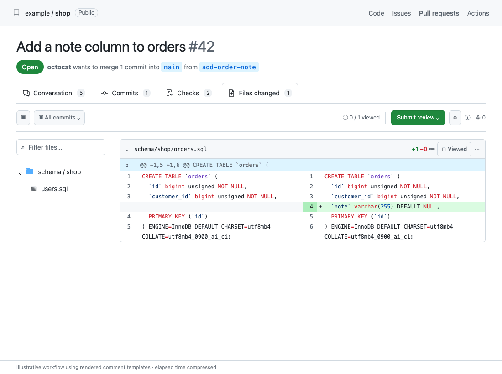
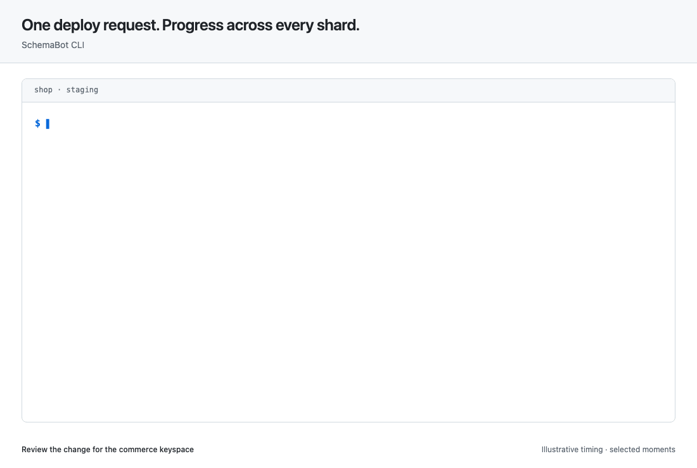

# Vitess on PlanetScale

<!-- BEGIN TOC (auto-generated by `make docs-toc`) -->

## Table of Contents

- [Quick start](#quick-start)
- [What runs and what is blocked](#what-runs-and-what-is-blocked)
- [Example: add a column to a sharded table](#example-add-a-column-to-a-sharded-table)
- [Where it runs](#where-it-runs)
- [How a change runs](#how-a-change-runs)
- [Keyspaces and VSchema](#keyspaces-and-vschema)
- [Reading progress](#reading-progress)
- [The revert window](#the-revert-window)
- [Control operations](#control-operations)
- [Throttling](#throttling)
- [Configuration and credentials](#configuration-and-credentials)
- [Service token permissions](#service-token-permissions)
- [Branch cleanup](#branch-cleanup)
- [Reclaiming orphaned branches](#reclaiming-orphaned-branches)
- [Failure and recovery](#failure-and-recovery)
- [Guidance for agents](#guidance-for-agents)

<!-- END TOC (auto-generated by `make docs-toc`) -->

SchemaBot runs Vitess schema changes on PlanetScale through branches and deploy
requests. Each apply prepares its changes on a development branch, then opens a
deploy request that carries them to the production branch, shard by shard.

Two things follow from that, and they shape the whole page. The DDL runs on the
branch first, so a statement Vitess will not accept fails against a throwaway
branch instead of a live table. And the deploy request, not SchemaBot, drives
the change, so the cluster reports progress and any instance can read it.



See [Engines](engines.md) for how this engine compares with the others.

## Quick start

### Try it on a sample database

With Docker running, run `schemabot init` in an empty directory, choose **Try a
sample database**, and pick Vitess:

```bash
schemabot init
```

SchemaBot starts a local Vitess cluster with a keyspace split across two
shards, seeds two tables, pulls them into schema files, and confirms the files
match the cluster. The first run downloads a multi-gigabyte cluster image, so
allow several minutes on a machine that has never run one; later runs reuse it.
Edit a file, then review and run the change:

```bash
schemabot plan -s schema -e development
schemabot apply -s schema -e development
```

When init prints its next command with a `--profile` flag, add the same flag to
both. [Initialize a database](init.md) walks through each step.

The sample runs two containers: the cluster, behind a PlanetScale-compatible
API, and a MySQL server holding SchemaBot's own state. It needs no PlanetScale
account. Because the keyspace is sharded, an apply reports progress per shard,
which is the part a single-server sample cannot show you.

### Bring an existing database

The init wizard does not create PlanetScale databases, so register an existing
one in the server configuration:

```yaml
databases:
  shop:
    type: vitess
    environments:
      production:
        organization: "your-org"
        token_secret_ref: "env:PLANETSCALE_TOKEN"
        dsn: "env:SHOP_VTGATE_DSN"
```

| Field | Is |
|---|---|
| `organization` | The PlanetScale organization holding the database |
| `token_secret_ref` | The service token, as `name:value`. See [Service token permissions](#service-token-permissions) |
| `dsn` | The vtgate MySQL endpoint, which SchemaBot only reads from. Required here: an environment SchemaBot runs itself is the one that carries a DSN. See [Reading progress](#reading-progress) |

Then pull the live schema into files, one directory per keyspace:

```
shop/schema/
├── schemabot.yaml
└── commerce/
    ├── vschema.json
    ├── customers.sql
    └── orders.sql
```

```yaml
# schemabot.yaml
database: shop
type: vitess
```

[Configuration and credentials](#configuration-and-credentials) covers mTLS,
secret references, and the other ways to supply each field.

## What runs and what is blocked

| Change | What happens |
|---|---|
| An `ALTER TABLE` Vitess can make by editing metadata | Runs as instant DDL, in milliseconds, with nothing to steer and no revert window. A held cutover or a destructive statement takes the copy path instead, so the change keeps its window |
| Any other `ALTER TABLE` | Runs as Vitess online DDL: a copy per shard, then a cutover. Throttled by the cluster, and it can be cancelled |
| A new table, with its indexes | Runs on the branch, then lands with the deploy request |
| A VSchema change | Applied to the keyspace alongside that keyspace's table changes. See [Keyspaces and VSchema](#keyspaces-and-vschema) |
| A table with no schema file, or a deleted file | Runs as `DROP TABLE` after you approve it with `--allow-unsafe`. Vitess holds the dropped table itself before purging it, so SchemaBot adds no quarantine of its own. See [Pending drops](pending-drops.md) |
| Anything declaring a foreign key | Blocked at plan. Vitess does not support them, and the plan says so rather than offering a wait that can only end in an error |
| Direct execution | Not available, by design. Raw DDL sent to vtgate would bypass the online DDL machinery this engine exists to use. See [direct-execution.md](direct-execution.md) |

The foreign key is the only rejection the plan predicts. Every other statement
Vitess will not accept is rejected when the DDL runs on the branch, before any
data is copied: the apply fails, against a throwaway branch, and the production
branch is never touched. Predicting the rest would mean reimplementing Vitess's
own DDL acceptance rules, and getting that wrong would refuse changes that work.

A deploy request that PlanetScale has configured to require approval fails the
apply. SchemaBot does not approve deploy requests. When PlanetScale refuses the
deploy, SchemaBot closes the deploy request it created, so nobody can deploy it
from PlanetScale after the apply has failed. SchemaBot never closes a deploy
request it did not create. When it does not close one, the server log names it,
and so does the apply's failure when the refusal answered the start of a deploy
that was waiting for it: close it in PlanetScale if the close failed or
SchemaBot did not create it, or check whether the change landed if PlanetScale
reports that its deploy may have begun.

## Example: add a column to a sharded table

The `orders` table is sharded on `customer_id`, and the pull request adds a
`note` column:

```sql
CREATE TABLE `orders` (
  `id` bigint unsigned NOT NULL,
  `customer_id` bigint unsigned NOT NULL,
  `note` varchar(255) DEFAULT NULL,
  PRIMARY KEY (`id`)
) ENGINE=InnoDB DEFAULT CHARSET=utf8mb4 COLLATE=utf8mb4_0900_ai_ci
```

The plan shows one `ALTER TABLE ... ADD COLUMN`. On apply, SchemaBot creates a
branch, runs that statement on it, and opens a deploy request. Every shard runs
its own copy of the change, so progress is four copies on a four-shard keyspace,
each with its own row count and estimate.



The CLI and the PlanetScale console control the same deploy request, with
PlanetScale as the source of truth. Running the cutover, reverting, or closing
the revert window works from either, and the CLI watcher follows along; there is
no need to repeat the action.
[Manage PlanetScale deploy requests](cli.md#manage-planetscale-deploy-requests)
has the full walkthrough.

## Where it runs

| Target | Notes |
|---|---|
| PlanetScale | The tested target |
| A PlanetScale-compatible endpoint | Works where it answers the same API. Some require mutual TLS; see [PlanetScale mTLS](configuration.md#planetscale-mtls) |

SchemaBot reaches the cluster through the PlanetScale API: it creates the
deploy branch and asks for that branch's password. The DDL itself runs over a
MySQL connection to the host the password names, so the apply needs no vtgate
DSN. Where the DSN is set, it is read-only: shards and schema, never DDL.

This engine needs the PlanetScale API, so it does not drive a self-hosted
Vitess cluster that lacks one. Sharded MySQL outside PlanetScale is the
[Strata](strata-engine.md) engine's, which runs through a remote deployment.

## How a change runs

```
  plan ---> create branch ---> run DDL on the branch ---> open deploy request
                                        |                          |
                            a statement Vitess                     v
                            refuses fails here,          [ copying, per shard ]
                            before any data moves                  |
                                                                   v
                                                        cutover (deferrable)
                                                                   |
                                                                   v
                                                        [ revert window ] ---> done
```

Each step, and what it costs you if it fails:

| Step | What happens |
|---|---|
| Create branch | A development branch, named so SchemaBot can recognize it later. See [Branch cleanup](#branch-cleanup) |
| Run DDL on the branch | The schema change is applied to the branch and verified against the schema files. A failure here costs a branch, nothing else |
| Open deploy request | The deploy request carries the branch's schema to the production branch. PlanetScale deletes the branch once it exists |
| Copy | Vitess online DDL, one copy per shard, throttled by the cluster |
| Cutover | The swap. `--defer-cutover` holds a finished copy here until an operator asks for it |
| Revert window | The original table is kept, and the change can be undone. See [The revert window](#the-revert-window) |

`--defer-deploy` stops one step earlier: the deploy request is created and left
undeployed, so you can review it before any copying starts. `start` then
launches it.

## Keyspaces and VSchema

Each keyspace is a directory, and `vschema.json` beside the table files declares
how that keyspace routes queries:

```
schema/
├── schemabot.yaml
├── commerce/            # sharded
│   ├── vschema.json
│   ├── customers.sql
│   └── orders.sql
└── lookup/              # unsharded
    ├── vschema.json
    └── regions.sql
```

A VSchema change applies to its keyspace alongside that keyspace's table
changes, so a table and the vindex that routes it land together. Pull writes
`vschema.json` back out with the tables, so a pulled schema round-trips.

The review gate compares a `vschema.json` by table, vindex, and keyspace
setting, not by file text, so reformatting it keeps an approval and rerouting a
table does not. A VSchema carrying a field the vendored Vitess definition does
not know counts as changed, and needs a fresh approval.

[Namespaces](namespaces.md) covers selecting and ignoring keyspaces.

## Reading progress

Vitess reports progress from the cluster rather than from the process driving
the change, so any SchemaBot instance can read it, and a restart does not
interrupt the reading. Each shard reports its own state, rows copied, and
estimate.

| With | Progress shows |
|---|---|
| A vtgate DSN | Per-shard state and row counts, read with `SHOW VITESS_MIGRATIONS` |
| No vtgate DSN | The deploy request's state alone, with no per-shard detail |

Polling uses both credentials on every poll: the service token reads the deploy
request's status, and, when the DSN is set, lists the production branch's
keyspaces; the vtgate credentials then read each keyspace's shards. A read-only
branch password is enough.

The apply itself runs without a DSN, since it reaches the branch with the
password the API hands back. An apply started without one logs that per-shard
progress will be unavailable. The DSN is still configured, because it is what
marks the environment as one SchemaBot runs itself rather than hands to a
deployment.

One case does need the DSN. Where PlanetScale's safe schema changes are turned
off on the branch, the plan reads the schema over vtgate instead, and fails
without one.

## The revert window

Vitess is the only engine SchemaBot drives that keeps the original table after
cutover. A change that copied has a window, and for its length the change can
be undone. An instant DDL has none: it edited metadata, so there is no original
table to put back, and the apply finishes without a window to wait out.

| Operation | Does |
|---|---|
| `revert` | Put the original table back |
| `skip-revert` | Close the window early and finalize the change |

The window is SchemaBot's. It stays open for `revert_window_duration` — 30
minutes by default, matching PlanetScale's — and SchemaBot closes it itself by
skipping the revert once that time has passed. A dropped table is kept
separately, by Vitess's own table lifecycle, which is why SchemaBot adds no
[pending drops](pending-drops.md) quarantine on this engine.

Reverting is not the same as rolling back. `revert` undoes a change while its
window is open; `rollback` is a fresh plan and apply that returns the schema to
an earlier state, and it works after the window has closed.

## Control operations

| Operation | On Vitess |
|---|---|
| `cancel` | Ends the deploy request for good. Nothing resumes it |
| `cutover` | Triggers the swap for a change held at a deferred cutover |
| `start` | Launches a deploy request created with `--defer-deploy`. It never resumes anything |
| `revert`, `skip-revert` | See [The revert window](#the-revert-window) |
| `stop` | Refused. A deploy request runs or it ends |

`stop` is refused rather than quietly carried out as a cancel. Asking to pause
says you mean to come back, and a cancel gives you nothing to come back to, so
the refusal names `cancel` and says plainly that it is permanent. The choice to
end a change stays the operator's. That is
[CO-8](invariants.md) in the invariant registry.

Every control command names the apply it acts on. See
[Follow and control a change](cli.md#follow-and-control-a-change).

## Throttling

Vitess gates rather than paces. Its throttler watches live cluster signals —
replication lag by default, and, where configured, running threads, load
average, InnoDB history list length, or a custom query — and each is a
threshold. The copy asks before each batch, and an unsatisfied answer means that
batch waits and asks again. The copy is not slowed down so much as let through
less often.

Both the signal thresholds and the throttle ratio an operator can set on a
running deploy request live on the PlanetScale side. SchemaBot neither sets them
nor surfaces them, so a throttled deploy request reads in SchemaBot as a copy
going slowly, and the reason is in PlanetScale. PlanetScale documents the
controls in
[Throttling deploy requests](https://planetscale.com/docs/vitess/schema-changes/throttling-deploy-requests).

[Load management](engines.md#load-management) compares this with how the other
engines behave under pressure.

## Configuration and credentials

A Vitess environment takes three fields and an optional revert window:

```yaml
databases:
  shop:
    type: vitess
    environments:
      staging:
        organization: "your-org"
        token_secret_ref: "secretsmanager:schemabot-staging/planetscale-token#token"
        dsn: "secretsmanager:schemabot-staging/planetscale-vtgate#dsn"
        revert_window_duration: "30m"
```

The fields do not take the same forms, so a reference in the wrong one is read
as the value itself:

| Field | Takes |
|---|---|
| `organization` | The name, as written. It is not resolved, so `env:PLANETSCALE_ORG` names an organization spelled that way |
| `token_secret_ref` | `env:`, `file:`, `secretsmanager:`, or the `name:value` token itself |
| `dsn` | `env:`, `file:`, `secretsmanager:`, or the connection string itself. `dsn_from` assembles one from parts instead, and only this field has it |

[Configuration](configuration.md) covers the reference forms, along with
[the service token](configuration.md#planetscale-service-token) and
[mTLS endpoints](configuration.md#planetscale-mtls).

`revert_window_duration` is how long [the revert window](#the-revert-window)
stays open after the deploy completes, as a Go duration. Omit it for the 30
minute default. A value that does not parse, or that is zero or negative, fails
config load rather than falling back to the default.

Credentials are resolved lazily, so a Vitess database left configured with a
placeholder organization does not stop the server from starting.

## Service token permissions

SchemaBot calls the PlanetScale API with a service token. Grant the token
these database access permissions on every database SchemaBot manages:

| Permission | What SchemaBot uses it for |
|---|---|
| `read_branch` | Wait for a branch to be ready, read its schema, list its keyspaces, and read each keyspace's VSchema. Also read the production branch: its schema during plan, its schema, keyspaces, and VSchema during pull, and its keyspaces during progress polling. The [branch reconcile pass](#reclaiming-orphaned-branches) also lists the database's branches |
| `create_branch` | Create the branch each apply prepares its schema change on |
| `delete_branch` | Delete that branch when the apply fails or is cancelled before its deploy request exists (see [Branch cleanup](#branch-cleanup)), and delete orphaned branches when the branch reconcile pass runs with `delete: true` |
| `connect_branch` | Create the branch password used to run DDL on the branch |
| `write_branch_vschema` | Apply VSchema changes to the branch |
| `create_deploy_request` | Create the deploy request and drive it: deploy, cutover, cancel, close, revert, and skip revert |
| `read_deploy_request` | Track a deploy request's progress and read back its cutover setting. The branch reconcile pass also lists each candidate branch's open deploy requests |

None of the production variants (`delete_production_branch`,
`connect_production_branch`, `write_production_branch_vschema`) is needed:
SchemaBot changes only the development branches it works on, and production
changes only through a deploy request. SchemaBot also does not approve deploy
requests or read or write their comments, so it needs neither
`approve_deploy_request` nor the comment permissions.

The bootstrap script `deploy/aws-multi-env/scripts/bootstrap-planetscale.sh`
grants exactly the permissions in the table above.

When an apply runs on an operator-supplied branch, SchemaBot also refreshes
that branch's schema from the production branch first. PlanetScale's API
reference does not list a permission for that call, so the table above may
not be enough for that path.

## Branch cleanup

`delete_branch` is the permission most likely to be missing, because only a
failure or a cancel uses it. An apply prepares its schema change on a branch
it creates, and the deploy request deletes that branch once it exists. When
the apply fails after the branch exists and before the deploy request is
created, SchemaBot deletes the branch itself so it does not hold branch
quota. That covers any failure in that window, on an apply's first drive and
on a drive that resumed it. An operator cancel in that window deletes the
branch the same way, and the apply log names the branch it removed. Two
cases keep the branch. A branch an operator supplied is never deleted; a
cancel says so on the apply log. A drive that ends before it finishes,
because its lease was lost, it stalled, or its instance shut down, keeps a
branch the apply's stored state names, for the driver that resumes the apply
from it; a branch the stored state does not name cannot be resumed, so it is
still deleted.

Without `delete_branch` the delete is refused. The apply still fails with its
own error, and SchemaBot logs the refused delete at error level with the
organization, database, and branch to delete by hand. When PlanetScale
refused the delete as unauthorized, the log also carries a `permission_hint`.
That answer does not say whether the service token is no longer accepted or
lacks `delete_branch`, so the hint says to check both. A cancel still
resolves, and its apply log names the branch left in place, says to check the
same two things, and says to delete the branch by hand.
Grant only `delete_branch`, not `delete_production_branch`: SchemaBot
deletes only the development branches it creates.

## Reclaiming orphaned branches

A branch survives its apply when the cleanup above does not finish: the drive
lost its lease part-way through the delete and no driver resumed the apply, or
PlanetScale refused the delete. No apply names that branch any more, so nothing
will delete it, and it holds branch quota until someone does.

The branch reconcile pass finds those branches. It runs with the operator:
each server runs it when it starts and then hourly, and an election keeps two
servers from running it at the same time, so a fleet of N servers runs it up
to N times an hour. Each run checks every PlanetScale database this server
executes against: each environment with a local `dsn`, including databases
registered after the server started, and, on a data plane that resolves
targets through `target_resolver`, each PlanetScale target of an apply that
was driven or settled in the last 30 days plus the grace period, however long
ago it was created. A data plane reaches each of those targets the way an
apply on it does. It reclaims a branch only when
all of these hold:

- its name has the shape SchemaBot gives the branches it creates for that
  database, so the production branch and operator-created branches are never
  touched;
- it is older than the grace period;
- no unsettled apply uses it, stopped applies included: not the branch its
  stored state names, not one an operator supplied, and not the one its plan
  would generate. The pass holds the apply target while it reads this a final
  time and deletes, so no apply can start on that target in between;
- no open deploy request uses it.

Anything the pass cannot read keeps the branch, and the next pass tries again.
A delete that fails is logged at error level and retried on the next pass.
When PlanetScale refused it as unauthorized, that log carries the same
`permission_hint` as [Branch cleanup](#branch-cleanup).
On a data plane, a recently applied target that the inventory no longer has,
or that has no PlanetScale client, is skipped with a warning and does not fail
the pass; its branches are kept until deleted by hand.
It is off by default, and when enabled it only logs the branches it would
delete until `delete: true` is set:

```yaml
branch_reconcile:
  enabled: true   # default: false
  delete: false   # default: false — log the orphaned branches instead of deleting them
  grace: 24h      # default: 24h
```

Run it with `delete: false` first and check the logged branches before
turning deletes on. Each decision is logged with the organization, database,
and branch. The pass judges a branch only against the applies in this
server's storage, so enable it only where no other SchemaBot installation
applies schema changes to the same PlanetScale database.

## Failure and recovery

**Restarts.** The deploy request keeps running whether or not SchemaBot is
there to watch it, because the cluster drives the copy. A SchemaBot instance
that restarts picks the apply back up and reads progress from the cluster; it
does not start the change over.

**Before the deploy request exists.** A failure here costs a branch and nothing
more. The DDL ran on the branch, the production branch was never touched, and
SchemaBot deletes the branch as [Branch cleanup](#branch-cleanup) describes.

**After it exists.** The deploy request is the source of truth. SchemaBot reads
its state rather than inferring one, so a cutover or a cancel an operator ran in
the PlanetScale console is read back as exactly that.

**A deploy request SchemaBot did not create.** An adopted deploy request holding
auto-cutover on is refused permanently: it would swap the schema on its own, and
that setting cannot be changed after creation. Close it in PlanetScale, then
plan and apply again.

## Guidance for agents

An agent works with a Vitess database the way it works with any database
SchemaBot manages: it plans and reads freely, and the
[SchemaBot agent skill](../skills/schemabot/references/command-policy.md)
decides which commands it may post.
[Working with AI agents](ai-agents.md) explains why people keep control of what
runs.

| An agent may | An agent hands it to a person |
|---|---|
| Run `plan`, `status`, `progress --no-watch`, and `pull` | `apply`, `cutover`, and `cancel` wherever the command policy says to hand them over, which includes production |
| Rewrite a blocked change into a form the plan accepts, then plan again | `revert` and `skip-revert` in production, and outside it unless the user says yes when the agent asks |
| Tell the user why a change was blocked or refused, in SchemaBot's words | Any DDL run against the cluster outside SchemaBot, and anything done in the PlanetScale console |
| Report a failure SchemaBot will retry, and check on it again | Deleting a branch, or approving a deploy request |

An agent with the [SchemaBot agent skill](ai-agents.md#install-the-agent-skill)
follows these rules. Its [Vitess](../skills/schemabot/references/refusals-and-failures.md#vitess) reference has the signal of
each outcome and what the agent does next.
